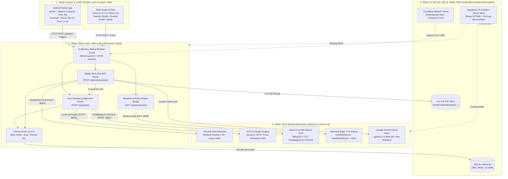
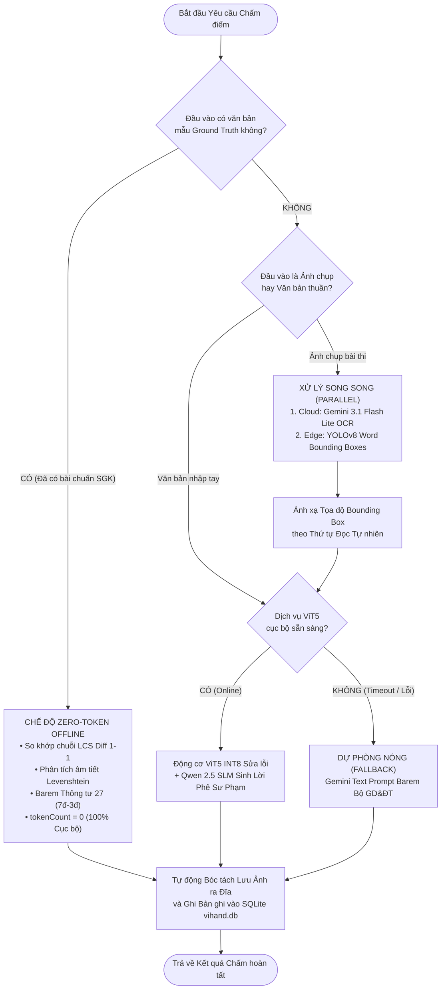
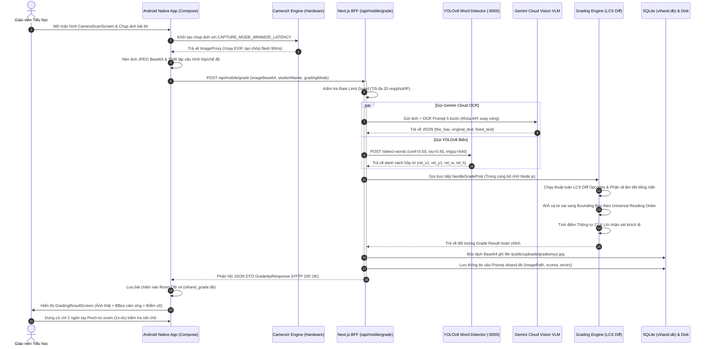
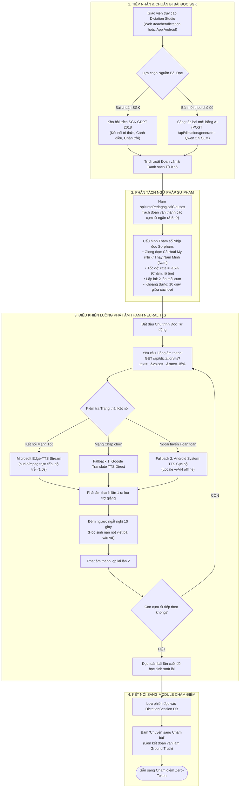
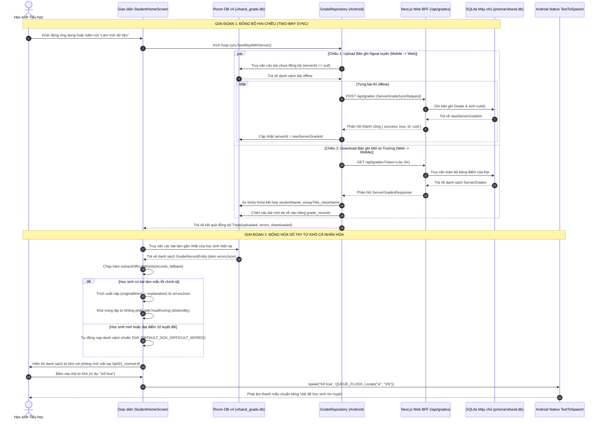

# BẢN THIẾT KẾ ĐẶC TẢ TỔNG QUAN KIẾN TRÚC TOÀN HỆ THỐNG VIHAND GRADE
## (Architectural Blueprint & Structural Specification for Document 1)

- **Mã tài liệu mục tiêu:** `01_Bao_cao_Nghien_cuu/Tai_lieu_Bao_cao/03_Dac_Ta_Kien_Truc_He_Thong/01_Tong_Quan_Kien_Truc_He_Thong_ViHandGrade.md`
- **Tác giả thiết kế:** Teamwork Explorer (System Architecture & Mermaid Blueprint Specialist)
- **Thời điểm biên soạn:** 2026-10-05T15:40:00Z
- **Không gian làm việc:** `c:\Users\Jackie Duong\Desktop\Web_sua_loi`
- **Nguyên tắc thiết kế:** 100% Khách quan, Căn cứ mã nguồn thực tế (Zero Assumptions, Zero Guesswork), Tuân thủ Thông tư 27/2020/TT-BGDĐT và Nghị định 13/2023/NĐ-CP.

---

## MỤC LỤC TỔNG THỂ

1. **PHẦN I: BỐI CẢNH GIÁO DỤC TIỂU HỌC, CHUYỂN ĐỔI SỐ VÀ KHUNG ĐÁNH GIÁ SƯ PHẠM (THÔNG TƯ 27/2020/TT-BGDĐT)**
   - 1.1. Bối cảnh Giáo dục Tiểu học & Thực trạng Chuyển đổi số trong Nhà trường
   - 1.2. Khung Đánh giá Sư phạm theo Thông tư 27/2020/TT-BGDĐT (Đánh giá Thường xuyên vs Định kỳ, Nhận xét Định tính)
   - 1.3. Phân môn & Ma trận Đánh giá Phân hóa: Chính tả (Ground Truth Alignment) vs Tập làm văn (Multi-Tier AI Evaluation)
   - 1.4. Phân loại 6 Nhóm Lỗi Ngữ âm Tiếng Việt Cốt lõi & Thang Xếp loại Học lực

2. **PHẦN II: KIẾN TRÚC HỆ THỐNG 4 TẦNG TOÀN DIỆN (THE 4-TIER SYSTEM ARCHITECTURE)**
   - 2.1. Tầng 1: Client & Thiết bị Đầu cuối (Client Tier)
     - Android Native App (`android_app/`): Kotlin 2.2.10, Jetpack Compose, CameraX, Room v4, UDF/MVVM, Co-Transformation gestures.
     - Web Studio & PWA (`app/`): Next.js 16.2.4, React 19, TypeScript, Tailwind CSS v4, RBAC 3 vai trò.
   - 2.2. Tầng 2: Cổng Giao tiếp & Backend-for-Frontend (Gateway / BFF Tier)
     - Next.js 16 App Router Route Handlers (24 routes, Zero Server Actions).
     - Endpoint trọng tâm `/api/mobile/grade`: All-in-one BFF Gateway.
     - Rate Limiting Guard (`lib/api-guard.ts`): In-memory Sliding Window, 60s cleanup.
   - 2.3. Tầng 3: Lõi Xử lý Trí tuệ Nhân tạo Đa Dịch vụ (AI Microservices Core Tier)
     - FastAPI Python Microservice (`python_service/main.py`: Port 8000).
     - YOLOv8 Word Detector: Thuật toán Vertical Overlap gom dòng tự nhiên, tọa độ tương đối.
     - Động cơ ViT5 Correction: Dynamic INT8 Quantization, Prose Chunking $\le 160$ chars, Levenshtein Syllable Matcher.
     - Mô hình SLM Qwen 2.5-0.5B-Instruct: Sinh nhận xét sư phạm ấm áp & sáng tác bài đọc SGK 2018.
     - Microsoft Edge-TTS: Giọng đọc truyền cảm `vi-VN-HoaiMyNeural` & `NamMinhNeural`, rate -15%.
     - Kênh Gemini Multimodal Vision Cloud Fallback: Xoay vòng Multi-API Keys, Prompt 5 bước.
   - 2.4. Tầng 4: Cơ sở Dữ liệu & Trạm Tính toán Biên (Database & Edge Computing Tier)
     - Prisma SQLite (`prisma/vihand.db`, WAL Mode, busy_timeout 5s, tách ảnh vật lý ra đĩa).
     - Room DB v4 (`vihand_grade.db`) trên Android Client & Đồng bộ hai chiều (`syncTwoWayWithServer`).
     - Trạm biên Raspberry Pi 4 Model B (4GB RAM) / NVIDIA Jetson Nano: Swap 3072MB, Cgroups resource limits, UFW firewall isolation, Cloudflare Named Tunnel Zero-Trust.

3. **PHẦN III: HỆ THỐNG SƠ ĐỒ MERMAID CHUẨN XÁC & HOÀN CHỈNH (VALID MERMAID BLUEPRINTS)**
   - 3.1. Sơ đồ Kiến trúc Tổng quan 4 Tầng Hệ thống (`graph TD`)
   - 3.2. Sơ đồ Mô hình Cộng tác Hybrid Edge-Cloud & Định tuyến Dự phòng Zero-Token Offline (`sequenceDiagram` & `flowchart TD`)
   - 3.3. Sơ đồ Quy trình Nghiệp vụ 1: Luồng Chấm điểm OCR Chữ viết tay Tự động (`sequenceDiagram`)
   - 3.4. Sơ đồ Quy trình Nghiệp vụ 2: Luồng Luyện viết Chính tả Sư phạm & Tổng hợp Giọng đọc Neural TTS (`flowchart TD`)
   - 3.5. Sơ đồ Quy trình Nghiệp vụ 3: Luồng Đồng bộ Sổ điểm & Sổ tay Từ khó Cá nhân hóa Hai chiều (`sequenceDiagram`)

4. **PHẦN IV: ĐẶC TẢ CÁC THUỘC TÍNH CHẤT LƯỢNG HỆ THỐNG (QUALITY ATTRIBUTES & NFRs)**
   - 4.1. An toàn Thông tin & Quyền Riêng tư Dữ liệu Trẻ em (Security & Child Privacy Protection - Nghị định 13/2023/NĐ-CP)
   - 4.2. Tính Sẵn sàng Cao & Khả năng Chịu lỗi (High Availability & Multi-Tier Resilience Matrix)
   - 4.3. Hiệu năng, Độ trễ & Ngân sách Bộ nhớ (Performance Latency Budgets & Memory Budgets)

5. **PHẦN V: MA TRẬN TRUY XUẤT NGUỒN VÀ TIÊU CHÍ NGHIỆM THU (CODE TRACEABILITY & VERIFICATION CRITERIA)**
   - 5.1. Ma trận Truy xuất Nguồn Mã Thực tế (Code Traceability Matrix)
   - 5.2. Tiêu chuẩn Kiểm thử & Xác thực Thực nghiệm PStack (Lauren Tan Methodology)

---

# PHẦN I: BỐI CẢNH GIÁO DỤC TIỂU HỌC, CHUYỂN ĐỔI SỐ VÀ KHUNG ĐÁNH GIÁ SƯ PHẠM (THÔNG TƯ 27/2020/TT-BGDĐT)

### 1.1. Bối cảnh Giáo dục Tiểu học & Thực trạng Chuyển đổi số trong Nhà trường

Trong khuôn khổ Chương trình Giáo dục Phổ thông 2018 (GDPT 2018), môn Tiếng Việt cấp Tiểu học đóng vai trò nền tảng định hình năng lực ngôn ngữ, tư duy logic và phẩm chất thẩm mỹ của học sinh. Tuy nhiên, quá trình chuyển đổi số trong công tác giảng dạy và đánh giá môn Tiếng Việt đang đối mặt với những rào cản nghiêm trọng:
1. **Áp lực quá tải sĩ số và thời gian chấm bài:** Một giáo viên chủ nhiệm thường phụ trách lớp học từ 35 đến 45 học sinh. Mỗi tuần, giáo viên phải chấm chữa từ 2 đến 3 bài viết tay (bao gồm cả tiết Chính tả nghe - viết và bài Tập làm văn). Tổng khối lượng bài viết cần chấm chữa lên tới hơn 100–150 bài/tuần.
2. **Đặc thù nét chữ viết tay học sinh tiểu học:** Chữ viết của học sinh Lớp 1 đến Lớp 5 mang tính chất biến thiên rất lớn: nét chữ nguệch ngoạc, nét thanh nét đậm chưa đều, khoảng cách từ không chuẩn, sai lệch dấu thanh, và viết đè lên các đường kẻ ô ly của vở học sinh. Việc ngồi chấm bài thủ công liên tục nhiều giờ gây suy giảm thị lực, mỏi mệt tâm lý và dễ dẫn đến sai sót chủ quan.
3. **Sự thiếu hụt giải pháp công nghệ chuyên biệt:** Các hệ thống OCR thương mại phổ biến hiện nay (như Google Cloud Vision, ABBYY, Tesseract) chủ yếu được tối ưu cho tài liệu văn phòng in sẵn (printed documents) hoặc chữ viết tay người lớn tiếng Anh. Khi áp dụng cho chữ viết tay tiếng Việt học sinh trên nền vở ô ly, tỷ lệ nhận diện sai dấu và đứt nét là rất cao.

### 1.2. Khung Đánh giá Sư phạm theo Thông tư 27/2020/TT-BGDĐT

Thông tư số **27/2020/TT-BGDĐT** ngày 04/09/2020 của Bộ Giáo dục và Đào tạo quy định rõ triết lý đánh giá học sinh tiểu học với 3 nguyên tắc cốt lõi:
- **Kết hợp Đánh giá Thường xuyên (Formative Assessment) và Đánh giá Định kỳ (Summative Assessment):** Đánh giá vì sự tiến bộ của học sinh; coi trọng việc động viên, khuyến khích sự cố gắng trong học tập, rèn luyện; không so sánh học sinh này với học sinh khác.
- **Chuyển trọng tâm từ "Cho điểm" sang "Nhận xét định tính":** Trong đánh giá thường xuyên, giáo viên không dùng điểm số để gây áp lực mà sử dụng lời nhận xét cụ thể: chỉ rõ chỗ đúng, chỗ sai, nguyên nhân mắc lỗi và biện pháp sửa chữa kịp thời.
- **Khen ngợi trước, góp ý sau:** Lời nhận xét sư phạm phải mang tính tích cực, truyền cảm hứng, khích lệ lòng tự tin của trẻ nhỏ.

Hệ thống **ViHand Grade** được thiết kế để số hóa và tự động hóa toàn diện triết lý này, cung cấp công cụ AI đóng vai trò "Trợ lý ảo sư phạm" đắc lực cho giáo viên.

### 1.3. Phân môn & Ma trận Đánh giá Phân hóa

Hệ thống thiết lập ranh giới nghiệp vụ độc lập và quy trình AI chuyên biệt cho 2 phân môn Tiếng Việt:

```
                                    ┌────────────────────────────────────────────────────────┐
                                    │ BÀI LÀM HỌC SINH (ẢNH CHỤP VỞ HOẶC VĂN BẢN TRỰC TIẾP)  │
                                    └───────────────────────────┬────────────────────────────┘
                                                                │
                                                    Phân định Chế độ Chấm
                                                   (Grading Mode Selector)
                                                  /                        \
                                                 /                          \
                    ┌───────────────────────────┴───┐                    ┌───┴───────────────────────────┐
                    │ PHÂN MÔN 1: CHÍNH TẢ          │                    │ PHÂN MÔN 2: TẬP LÀM VĂN       │
                    │ (Nghe - Viết / Nhìn - Viết)   │                    │ (Đoạn văn ngắn, Kể chuyện...) │
                    └───────────────┬───────────────┘                    └───────────────┬───────────────┘
                                    │                                                    │
                      Có Ngữ liệu Mẫu (Ground Truth)?                     Nhận diện Nét chữ & Sửa lỗi
                     ├── CÓ: Đối soát chuỗi 1-1                          ├── Gemini Vision OCR trích xuất text
                     │   (LCS Diff Opcodes)                              ├── ViT5 Seq2Seq sửa lỗi chính tả
                     │   Zero-Hallucination, 0 Token                     └── Phân tích nghệ thuật & sáng tạo
                     └── KHÔNG: ViT5/Gemini Fallback                                     │
                                    │                                                    │
                    ┌───────────────┴───────────────┐                    ┌───────────────┴───────────────┐
                    │ BAREM ĐIỂM CHÍNH TẢ (10 ĐIỂM) │                    │ BAREM TẬP LÀM VĂN (10 ĐIỂM)   │
                    │ • Chính tả: 7.0đ (trừ 0.5đ/lỗi)│                   │ • Chính tả: 4.0đ              │
                    │ • Hình thức & Chữ viết: 3.0đ  │                    │ • Hình thức & Trình bày: 3.0đ │
                    │ • Nội dung: 0.0đ (Cố định)    │                    │ • Nội dung & Bố cục: 2.0đ     │
                    │ • Sáng tạo: 0.0đ (Cố định)    │                    │ • Sáng tạo & Cảm xúc: 1.0đ    │
                    └───────────────────────────────┘                    └───────────────────────────────┘
```

#### Bảng Ma trận So sánh Nghiệp vụ Hai Phân môn:

| Tiêu chí so sánh | Phân môn Chính tả (Dictation) | Phân môn Tập làm văn (Essay) |
| :--- | :--- | :--- |
| **Bản chất yêu cầu** | Tái hiện chính xác văn bản bài đọc mẫu; rèn luyện kỹ năng nghe, phân tích âm thanh và tốc độ viết. | Diễn đạt ý tưởng, xây dựng câu đoạn, sử dụng từ ngữ gợi cảm, biện pháp tu từ theo chủ đề. |
| **Văn bản đối chiếu** | Bắt buộc có **Ground Truth Text** (lấy từ phiên đọc chính tả `/teacher/dictation` hoặc bài trích SGK). | Không có văn bản mẫu cố định; văn bản chuẩn do **ViT5** và **Gemini** hiệu đính từ bài làm. |
| **Cơ chế đánh giá AI** | **Deterministic String Alignment (LCS Diff):** Triệt tiêu hoàn toàn ảo giác (Zero-Hallucination), không tốn token LLM. | **Two-Tier Hybrid AI:** Tầng 1 phân tích cấu trúc ngữ pháp/từ láy; Tầng 2 dùng SLM Qwen 2.5 sinh lời phê. |
| **Cơ cấu Barem điểm** | - Điểm Chính tả: **7.0 điểm** (trừ 0.5đ cho mỗi lỗi sai âm, vần, dấu thanh).<br>- Điểm Hình thức & Chữ viết: **3.0 điểm** (trình bày, sạch sẽ). | - Điểm Chính tả: **4.0 điểm** (trừ 0.5đ/lỗi).<br>- Điểm Hình thức: **3.0 điểm**.<br>- Điểm Nội dung: **2.0 điểm**.<br>- Điểm Sáng tạo: **1.0 điểm** (đếm từ láy, câu so sánh, nhân hóa). |
| **Lời nhận xét sư phạm** | Tập trung vào mức độ cẩn thận, tỷ lệ hoàn thành bài nghe, chỉ rõ các âm/vần học sinh hay nhầm lẫn để rèn thêm. | Khen ngợi ý tưởng hay, từ ngữ sáng tạo giàu hình ảnh trước; sau đó nhẹ nhàng hướng dẫn sửa lỗi diễn đạt/chính tả. |

### 1.4. Phân loại 6 Nhóm Lỗi Ngữ âm Tiếng Việt Cốt lõi & Thang Xếp loại Học lực

#### 6 Nhóm Lỗi Ngữ âm Tiếng Việt Chuẩn Sư phạm:
Dựa trên cấu trúc âm tiết tiếng Việt 5 thành phần: $\text{Âm tiết} = \text{Âm đầu} + \text{Âm đệm/Nguyên âm chính} + \text{Âm cuối} + \text{Dấu thanh}$, hệ thống phân loại chính xác các lỗi viết sai của học sinh:
1. **Lỗi Phụ âm đầu (`phu_am_dau` - Màu Hồng Rose `#F43F5E`):** Nhầm lẫn các cặp phụ âm có cách phát âm tương đồng theo phương ngữ (*ch/tr, s/x, d/gi/r, l/n, c/k/q, ng/ngh, g/gh*). Ví dụ: *"con châu"* $\rightarrow$ *"con trâu"*.
2. **Lỗi Dấu thanh (`dau_thanh` - Màu Tím Purple `#A855F7`):** Nhầm lẫn thanh hỏi/ngã, sắc/nặng do phương ngữ miền Trung và miền Nam. Ví dụ: *"nghĩ ngơi"* $\rightarrow$ *"nghỉ ngơi"*.
3. **Lỗi Vần khó (`van` - Màu Cam Orange `#F97316`):** Nhầm lẫn các vần có kết cấu phức tạp. Ví dụ: *"khoeo chân"* $\rightarrow$ *"kheo chân"*, *"loang ngoang"* $\rightarrow$ *"loằng ngoằng"*.
4. **Lỗi Nguyên âm chính (`am_chinh` - Màu Xanh ngọc Emerald `#10B981`):** Viết sai âm chính (*i/y, o/ô/ơ, u/ư, ie/iê*). Ví dụ: *"líu no"* $\rightarrow$ *"líu lo"*.
5. **Lỗi Âm cuối (`phu_am_cuoi` - Màu Xanh trời Sky `#0EA5E9`):** Nhầm lẫn các phụ âm khép âm tiết (*c/t, n/ng, p/t*). Ví dụ: *"man mác"* $\rightarrow$ *"man mát"*, *"buôn làng"* $\rightarrow$ *"buôn làn"*.
6. **Lỗi Viết hoa (`viet_hoa` - Màu Xanh dương Blue `#2563EB`):** Không viết hoa chữ cái đầu dòng thơ, đầu câu văn xuôi, hoặc danh từ riêng chỉ người/địa danh. Ví dụ: *"hà nội"* $\rightarrow$ *"Hà Nội"*.

#### Thang Xếp loại Học lực Theo Thông tư 27:
- **Hoàn thành xuất sắc (Mã màu `#059669`):** Tổng điểm $\ge 9.0$. Nắm vững kiến thức, chữ viết sạch đẹp, không mắc lỗi chính tả hoặc chỉ sai sót nhỏ không đáng kể.
- **Hoàn thành tốt (Mã màu `#0284C7`):** Tổng điểm từ $7.0 \dots < 9.0$. Hoàn thành tốt yêu cầu bài học, chữ viết rõ ràng, mắc từ 1 đến 2 lỗi nhỏ.
- **Hoàn thành (Mã màu `#D97706`):** Tổng điểm từ $5.0 \dots < 7.0$. Đạt yêu cầu tối thiểu, còn mắc từ 3 đến 5 lỗi chính tả, cần giáo viên lưu ý nhắc nhở.
- **Chưa hoàn thành / Cần cố gắng (Mã màu `#DC2626`):** Tổng điểm $< 5.0$. Mắc nhiều lỗi chính tả cơ bản, chữ viết chưa đạt, cần có kế hoạch kèm cặp riêng từ giáo viên.

---

# PHẦN II: KIẾN TRÚC HỆ THỐNG 4 TẦNG TOÀN DIỆN (THE 4-TIER SYSTEM ARCHITECTURE)

Hệ sinh thái **ViHand Grade** được tổ chức thành 4 tầng kiến trúc tách biệt nhưng gắn kết chặt chẽ qua các hợp đồng API tiêu chuẩn:

```
┌──────────────────────────────────────────────────────────────────────────────────────────────────┐
│ 1. TẦNG CLIENT & THIẾT BỊ ĐẦU CUỐI (CLIENT TIER)                                                 │
│  ┌──────────────────────────────────────────────┐    ┌─────────────────────────────────────────┐ │
│  │ Android Native Client (Kotlin / Compose)    │    │ Web Studio & PWA (Next.js 16 / React 19)│ │
│  │ • SDK 36 (Android 16), Min SDK 24            │    │ • Tailwind CSS v4 + Radix UI            │ │
│  │ • CameraX 1.5.0 (Low-latency capture)        │    │ • Service Worker offline cache (PWA)    │ │
│  │ • Lockstep Co-Transformation (Pinch 1x-4x)   │    │ • AI Grading Studio (5-Step Stepper)    │ │
│  │ • Dynamic Difficult Words Notebook           │    │ • Dictation Studio & SGK Corpus Browser │ │
│  │ • Room Database v4 (vihand_grade.db)         │    │ • Admin Control Center & System Monitor │ │
│  └──────────────────────────────────────────────┘    └─────────────────────────────────────────┘ │
└─────────────────────────────────┬──────────────────────────────────────┬─────────────────────────┘
                                  │ HTTP REST DTO (GradeApiRequest)      │ Web Fetch
                                  ▼                                      ▼
┌──────────────────────────────────────────────────────────────────────────────────────────────────┐
│ 2. TẦNG CỔNG GIAO TIẾP & BFF GATEWAY (GATEWAY / BFF TIER - Next.js 16 App Router :3000)          │
│  ┌─────────────────────────────────────────────────────────────────────────────────────────────┐ │
│  │ In-Memory Sliding Window Rate Limiting Guard (lib/api-guard.ts - 20-60 req/min/IP)          │ │
│  ├─────────────────────────────────────────────────────────────────────────────────────────────┤ │
│  │ RBAC Session Security & Route Protection (Admin, Teacher, Student)                          │ │
│  ├─────────────────────────────────────────────────────────────────────────────────────────────┤ │
│  │ All-in-one Mobile Gateway: POST /api/mobile/grade (Parallel Gemini OCR + YOLOv8)            │ │
│  ├─────────────────────────────────────────────────────────────────────────────────────────────┤ │
│  │ Grading Pipeline Orchestrator: POST /api/grade (LCS Diff, ViT5, Gemini Fallback)            │ │
│  ├─────────────────────────────────────────────────────────────────────────────────────────────┤ │
│  │ Pure TS Jimp 9-Step Image Preprocessor: POST /api/preprocess (Deskew, CLAHE, Shadow)        │ │
│  ├─────────────────────────────────────────────────────────────────────────────────────────────┤ │
│  │ Dictation & Audio Stream Bridge: GET /api/dictation/tts -> Edge-TTS / Google TTS            │ │
│  └─────────────────────────────────────────────────────────────────────────────────────────────┘ │
└─────────────────────────────────┬──────────────────────────────────────┬─────────────────────────┘
                                  │ Local Loopback (Port 8000)           │ Multi-Key HTTPS
                                  ▼                                      ▼
┌─────────────────────────────────────────────────────────────────┐ ┌──────────────────────────────┐
│ 3. TẦNG LÕI AI MICROSERVICES (FASTAPI PYTHON CORE :8000)        │ │ TẦNG CLOUD DỊCH VỤ VLM       │
│  ┌────────────────────────────────────────────────────────────┐ │ │ ┌──────────────────────────┐ │
│  │ YOLOv8 Word Detector (yolo_detector.py)                    │ │ │ │ Google Gemini API        │ │
│  │ • Trọng số: best.pt (640x640, imgsz=640)                   │ │ │ │ • gemini-3.1-flash-lite  │ │
│  │ • Thuật toán Vertical Overlap (0.40) gom dòng tự nhiên     │ │ │ │ • gemini-2.5-flash       │ │
│  │ • Chuẩn hóa tọa độ tương đối rel_x, rel_y ∈ [0, 1]         │ │ │ │ • Xoay vòng Multi-Keys   │ │
│  ├────────────────────────────────────────────────────────────┤ │ │ │ • Prompt trích xuất thô  │ │
│  │ ViT5 Vietnamese Correction Engine (main.py)                │ │ │ │   100% giữ nguyên lỗi    │ │
│  │ • Mô hình: chamdentimem/ViT5_Vietnamese_Correction (226M)  │ │ │ └──────────────────────────┘ │
│  │ • Lượng tử hóa Dynamic INT8 CPU (Tiết kiệm 50% RAM)        │ │ └──────────────┬───────────────┘
│  │ • Prose Chunking ≤ 160 ký tự (Chống lặp vô hạn)            │ │                │
│  │ • Bộ lọc Teencode 40+ regex & ACCIDENTAL_REPEAT_WORDS      │ │                │
│  │ • Levenshtein Syllable Matcher (Phân loại 6 nhóm lỗi)      │ │                │
│  ├────────────────────────────────────────────────────────────┤ │                │
│  │ Qwen 2.5-0.5B-Instruct SLM (main.py)                       │ │                │
│  │ • Độ chính xác: bfloat16 (~577MB RAM)                      │ │                │
│  │ • Sinh 3 phương án nhận xét sư phạm ấm áp Thông tư 27      │ │                │
│  │ • Sáng tác đoạn văn chính tả SGK GDPT 2018 theo khối lớp   │ │                │
│  ├────────────────────────────────────────────────────────────┤ │                │
│  │ Microsoft Edge-TTS Synthesis Engine (main.py)              │ │                │
│  │ • vi-VN-HoaiMyNeural (Nữ) & vi-VN-NamMinhNeural (Nam)       │ │                │
│  │ • Tham số sư phạm: rate = "-15%", stream MP3 trực tiếp     │ │                │
│  └────────────────────────────────────────────────────────────┘ │                │
└─────────────────────────────────┬───────────────────────────────┘                │
                                  │ Direct File / IPC                              │
                                  ▼                                                │
┌──────────────────────────────────────────────────────────────────────────────────┴───────────────┐
│ 4. TẦNG CƠ SỞ DỮ LIỆU & TRẠM TÍNH TOÁN BIÊN (DATABASE & EDGE COMPUTING APPLIANCE TIER)           │
│  ┌─────────────────────────────────────────────────────────────────────────────────────────────┐ │
│  │ Prisma SQLite Engine (prisma/vihand.db - 22.4MB)                                            │ │
│  │ • PRAGMA journal_mode = WAL; PRAGMA busy_timeout = 5000; PRAGMA synchronous = NORMAL;       │ │
│  │ • Tách ảnh vật lý ra đĩa (public/uploads/grades/...), cột imageBase64 rỗng chống phình to   │ │
│  │ • Chính sách lưu trữ 365 ngày (expiresAt) & Soft Purge ẩn danh hóa theo Nghị định 13/2023    │ │
│  ├─────────────────────────────────────────────────────────────────────────────────────────────┤ │
│  │ Trạm Biên Phần Cứng (Hardware Appliance: Raspberry Pi 4 Model B 4GB / Jetson Nano 4GB)       │ │
│  │ • Hoán đổi bộ nhớ (Swap): 3072MB (vm.swappiness = 20) chống tràn RAM OOM Killer             │ │
│  │ • Phân bổ tài nguyên CGroups: vihand-python (MemoryMax 2.5GB), vihand-web (MemoryMax 2.0GB)  │ │
│  │ • Tường lửa UFW: Khóa cổng 8000 từ bên ngoài, chỉ mở cổng 3000 (Web Gateway) & 22 (SSH)     │ │
│  │ • Cloudflare Named Tunnel (vihandgrade.click): Ingress TLS an toàn, không cần mở port mạng │ │
│  └─────────────────────────────────────────────────────────────────────────────────────────────┘ │
└──────────────────────────────────────────────────────────────────────────────────────────────────┘
```

### 2.1. Tầng 1: Client & Thiết bị Đầu cuối (Client Tier)

#### A. Ứng dụng Di động Android Native (`android_app/`)
Được xây dựng theo chuẩn Google Modern Android Development (MAD) đáp ứng tiêu chuẩn trải nghiệm giáo viên di động:
- **Ngôn ngữ & Thư viện nòng cốt:** Kotlin `2.2.10`, Jetpack Compose BOM `2024.09.00`, Compile/Target SDK `36` (Android 16), Min SDK `24` (Android 7.0), Java 11 bytecode compatibility.
- **Mô hình Kiến trúc UDF & MVVM:** Luồng dữ liệu một chiều nghiêm ngặt với `MainViewModel` và `ReportsViewModel`. Quản lý trạng thái bằng `MutableStateFlow`, công khai ra ngoài dạng `StateFlow` bất biến, và thu thập reactive trên Compose UI qua `collectAsStateWithLifecycle()`.
- **Cơ chế Cử chỉ Đồng bộ Tuyệt đối (Lockstep Co-Transformation):**
  Thành phần `PhotoBoundingBoxViewer.kt` (751 dòng) giải quyết triệt để lỗi lệch tọa độ bounding box khi xem bài thi:
  Cả **Layer 1** (Ảnh chụp bài thi từ Coil) và **Layer 2** (Lưới phủ Bounding Box cảm ứng) được đặt chung trong một vùng `Box` duy nhất mang modifier `graphicsLayer { scaleX = scale; scaleY = scale; translationX = offsetX; translationY = offsetY }`. Cử chỉ hai ngón tay `detectTransformGestures` hỗ trợ phóng to từ $1.0\times$ đến $4.0\times$ và kéo rê (pan). Nhờ co dãn trong cùng ma trận biến đổi đồ họa phần cứng, các hộp bounding box bám dính $1:1$ với từng nét mực học sinh trên ảnh.
- **Kính ngắm CameraX Chuyên Dụng (`CameraScanScreen.kt`):**
  Tích hợp `androidx.camera.view.PreviewView` với chế độ `CAPTURE_MODE_MINIMIZE_LATENCY`. Tự động xoay ảnh theo góc EXIF `rotationDegrees`, hiệu ứng chớp flash màn hình $90\text{ms}$ tạo phản hồi bấm chụp tức thì. Hỗ trợ **Chế độ quét liên tục cả lớp (Continuous Batch Scan)** cho phép giáo viên chụp liên tiếp 30–40 bài thi vào hàng đợi đệm để xử lý tuần tự.
- **Sổ tay Từ khó Động (`StudentHomeScreen.kt`):**
  Tự động trích xuất các từ bị viết sai từ các bài chấm gần nhất của học sinh (`extractDifficultWords`). Tích hợp `android.speech.tts.TextToSpeech` phát âm bản xứ tiếng Việt chuẩn `Locale("vi", "VN")` khi học sinh chạm vào từng từ khó. Hiển thị chữ viết tay bằng phông chuẩn tiểu học `hp001_normal.ttf`.
- **Bộ lọc & Tìm kiếm Không dấu Chuẩn xác (`HistoryScreen.kt`):**
  Thuật toán chuẩn hóa NFD loại bỏ dấu thanh tiếng Việt kết hợp ánh xạ ký tự `Đ/đ` giúp giáo viên tìm kiếm tên học sinh tức thì ngay cả khi gõ không dấu (`bao nam` $\rightarrow$ `Nguyễn Bảo Nam`). Bộ lọc Filter Chips phân loại theo Thể loại và 4 khoảng điểm số Thông tư 27.
- **Độ tin cậy & Kiểm thử:** Vượt qua 100% bộ kiểm thử tự động **23/23 Tests** (Robolectric SDK 36 Pixel 8, Unit tests, Roborazzi snapshot tests, stress tests). Kích thước APK tối ưu: `25.38 MB` (`app-debug.apk`).

#### B. Nền tảng Web Studio & PWA (`app/`)
- **Nền tảng công nghệ:** Next.js `16.2.4` (App Router), React `19`, TypeScript `5.7.3`, Tailwind CSS `v4`, Radix UI.
- **3 Phân hệ giao diện theo vai trò (RBAC):**
  - **Giáo viên (`/teacher`):** AI Grading Studio (quy trình 5 bước với Bounding Box interactive editor), Dictation Studio (nghe - phát âm Edge-TTS với 50+ bài trích SGK GDPT 2018), Sổ điểm lớp học và biểu đồ phổ điểm Recharts.
  - **Học sinh (`/student`):** Dashboard rèn luyện, Sổ tay từ khó cá nhân hóa kèm audio phát âm, Tra cứu lịch sử bài thi và xem lại ảnh bài làm gốc.
  - **Quản trị viên (`/admin`):** Quản lý người dùng & lớp học, Giám sát tài nguyên hệ thống (CPU, RAM, độ trễ, token), Thiết lập chính sách bảo vệ dữ liệu trẻ em theo Nghị định 13/2023.
- **Khả năng PWA:** Hỗ trợ cài đặt trên máy tính bảng giáo viên với Service Worker (`/app/sw.js`) và Dynamic App Icons.

---

### 2.2. Tầng 2: Cổng Giao tiếp & Backend-for-Frontend (Gateway / BFF Tier)

Hệ thống triển khai mô hình BFF thông qua App Router của Next.js 16 bao gồm **24 route handlers** (38 HTTP methods), không sử dụng Server Actions nhằm bảo đảm tính tương thích RESTful nguyên bản giữa Web Client và Android Client.

#### Điểm Nhấn: Gateway Đa Năng `/api/mobile/grade`
Được thiết kế chuyên biệt cho ứng dụng Android Native, thực hiện toàn bộ chuỗi xử lý phức tạp chỉ trong một lời gọi mạng duy nhất:
1. **Kiểm soát Tần suất:** Gọi `guardAiRoute(req, 20)` bảo vệ endpoint không vượt quá 20 req/phút/IP.
2. **Xử lý Song song (Parallel Processing):** Kích hoạt đồng thời qua `Promise.all`:
   - `runGeminiOCR`: Gọi Gemini Vision OCR với cơ chế xoay vòng Multi-API Keys trích xuất `original_text` và `fixed_text`.
   - `detectYoloBoxes`: Gửi ảnh sang Python AI Core `POST http://127.0.0.1:8000/detect-words` để quét tọa độ Bounding Box của từng từ.
3. **Gọi Trực tiếp Trong Bộ Nhớ (In-process Direct Invocation):**
   Gọi trực tiếp hàm `handleGradePost` của `app/api/grade/route.ts` trong cùng tiến trình Node.js (Zero-network delay) để thực thi thuật toán so khớp Levenshtein và sinh điểm Thông tư 27.
4. **Ánh xạ Hợp đồng (Data Transformation):** Chuyển đổi toàn bộ kết quả sang cấu trúc DTO `GradeApiResponse` khớp 100% với Moshi Adapter phía Android.
5. **Tự động Lưu trữ (Auto Persistence):** Tự động bóc tách ảnh Base64 ghi file vật lý ra đĩa và lưu bản ghi kết quả vào bảng `Grade` trong Prisma `vihand.db`.

#### Bộ Lọc Tần Suất Cửa Sổ Trượt (In-Memory Sliding Window Rate Limiting)
Triển khai tại `lib/api-guard.ts` (84 dòng):
- Lưu trữ danh sách mốc thời gian truy cập trong `Map<string, { timestamps: number[] }>`.
- Chu kỳ dọn rác tự động `setInterval` mỗi 60 giây dọn sạch các IP không hoạt động, loại bỏ triệt để rò rỉ bộ nhớ (Memory Leak).
- Hạn mức: `/api/mobile/grade` (20 req/phút), `/api/grade` (30 req/phút), `/api/yolo/detect` (60 req/phút).
- Khi vi phạm: Phản hồi HTTP `429 Too Many Requests` kèm headers chuẩn `Retry-After`, `X-RateLimit-Limit`, `X-RateLimit-Remaining`.

---

### 2.3. Tầng 3: Lõi Xử lý Trí tuệ Nhân tạo Đa Dịch vụ (AI Microservices Core Tier)

Được xây dựng trên nền tảng **FastAPI** (`python_service/main.py`), vận hành độc lập tại cổng `8000`:

#### 1. YOLOv8 Word Detector & Thuật Toán Vertical Overlap (`python_service/yolo_detector.py`)
- **Trọng số mô hình:** `best.pt` được huấn luyện chuyên biệt trên tập dữ liệu vở ô ly học sinh tiểu học Việt Nam. Kích thước ảnh chuẩn hóa `imgsz = 640`.
- **Thuật toán Gom dòng Vertical Overlap (Ngưỡng 0.40):**
  Khắc phục nhược điểm của thuật toán quét tâm $y_{mid}$ khi gặp các ký tự vươn cao (*b, h, l, d*) hoặc hạ thấp (*g, y, p*). Thuật toán tính toán độ giao thoa theo phương thẳng đứng giữa hộp chữ mới và dải bao trung bình của dòng kẻ:
  $$\text{overlap\_ratio} = \frac{\max(0.0, \min(by_2, \text{line\_y2\_avg}) - \max(by_1, \text{line\_y1\_avg}))}{\min(\text{box\_h}, \text{line\_h})}$$
  Nếu $\text{overlap\_ratio} \ge 0.40$, từ được xếp vào dòng tương ứng. Sau đó sắp xếp dòng từ trên xuống dưới và từ trong dòng từ trái sang phải theo thứ tự đọc tự nhiên.
- **Tọa độ tương đối:** Toàn bộ bounding box được chuẩn hóa về dải $[0.0, 1.0]$ (`rel_x1, rel_y1, rel_w, rel_h`).

#### 2. Động Cơ Sửa Lỗi Chính Tả ViT5 & Phân Loại Âm Tiết (`python_service/main.py`)
- **Mô hình định danh:** `chamdentimem/ViT5_Vietnamese_Correction` (Seq2Seq Transformer, 226M tham số).
- **Dynamic INT8 Quantization:** Lượng tử hóa động các lớp tuyến tính (`torch.qint8`), giảm dung lượng RAM chiếm dụng từ 1.1GB xuống còn **~510MB**, tăng tốc suy luận CPU từ 30% đến 50%.
- **Giải pháp Chia Đoạn Ngắt Câu (Prose Chunking $\le 160$ ký tự):**
  Chia nhỏ đoạn văn theo dấu chấm câu sao cho độ dài mỗi đoạn $\le 160$ ký tự ($\approx 240$ SentencePiece tokens), vừa vặn trong cửa sổ ngữ cảnh `max_length = 256`. Tuyệt đối không dùng cửa sổ trượt (sliding window) để triệt tiêu hoàn toàn hiện tượng lặp lại câu trước trong output.
- **Bộ Phân tích Âm tiết & So khớp Levenshtein (Syllable Parser):**
  Bóc tách âm tiết tiếng Việt thành 5 thành phần (âm đầu, âm đệm, âm chính, âm cuối, dấu thanh). Kết hợp `difflib.SequenceMatcher` để phân loại chính xác 6 nhóm lỗi ngữ âm và tính điểm trừ 0.5đ/lỗi.

#### 3. Mô Hình Sinh Ngôn Ngữ Nhỏ Qwen 2.5-0.5B-Instruct
- **Cấu hình tài nguyên:** Chạy ở độ chính xác `bfloat16`, chỉ tiêu tốn **~577MB RAM**, rất phù hợp cho Raspberry Pi 4.
- **Nhiệm vụ 1: Lời nhận xét sư phạm ấm áp:** Nhận diện các biện pháp tu từ (so sánh, từ láy, nhân hóa) từ Tier-1 Analyzer, sinh 3 phương án nhận xét khích lệ theo đúng tinh thần Thông tư 27 (khen ngợi sáng tạo trước, nhắc lỗi chính tả sau).
- **Nhiệm vụ 2: Sáng tác bài đọc SGK 2018:** Sinh đoạn văn chính tả theo khối lớp (1 đến 5), chủ đề bài học và trích xuất danh sách từ khó viết.

#### 4. Động Cơ Phát Âm Chuẩn Sư Phạm Microsoft Edge-TTS
- Tích hợp thư viện `edge-tts` với 2 giọng đọc tự nhiên: **Cô Hoài My** (`vi-VN-HoaiMyNeural`) và **Thầy Nam Minh** (`vi-VN-NamMinhNeural`).
- Thiết lập tốc độ đọc `rate = "-15%"` mô phỏng nhịp đọc bài chuẩn mực của giáo viên tiểu học. Stream trực tiếp dữ liệu âm thanh qua HTTP GET `/tts` với độ trễ $< 1.0$ giây.

#### 5. Kênh Gemini Vision Multimodal Cloud OCR
- Sử dụng mô hình `gemini-3.1-flash-lite` làm kênh nhận diện thị giác chính từ ảnh chụp bài thi thô.
- Thiết lập `temperature: 0.05` và prompt 5 bước bắt buộc giữ nguyên 100% lỗi sai của học sinh và ràng buộc số từ tương ứng $1:1$ giữa `original_text` và `fixed_text`.
- Hỗ trợ xoay vòng nhiều API keys khi chạm hạn mức HTTP 429 và fallback sang `gemini-2.5-flash`.

---

### 2.4. Tầng 4: Cơ sở Dữ liệu & Trạm Tính toán Biên (Database & Edge Computing Tier)

#### 1. Cơ Sở Dữ Liệu Prisma SQLite (`prisma/vihand.db`)
- **Tối ưu hóa đa kết nối (High Concurrency Design):**
  Kích hoạt chế độ Write-Ahead Logging thông qua `lib/prisma.ts`:
  ```sql
  PRAGMA journal_mode = WAL;
  PRAGMA busy_timeout = 5000;
  PRAGMA synchronous = NORMAL;
  ```
  Cho phép nhiều kết nối đọc chạy song song không bị chặn bởi 1 kết nối ghi, loại bỏ triệt để lỗi `"database is locked"` khi học sinh nộp bài đồng loạt.
- **Chống Phình to Cơ sở Dữ liệu (Image Bloat Shield):**
  Hàm `saveImageToDisk` bóc tách Base64 và ghi tệp ảnh vật lý vào `public/uploads/grades/${Date.now()}-${random}.jpg`. Cột `imageBase64` trong DB được để rỗng, chỉ lưu đường dẫn `imagePath`, giữ cho kích thước `vihand.db` ổn định (~22.4 MB).

#### 2. Cơ Sở Dữ Liệu Cục Bộ Room DB v4 (`vihand_grade.db`)
- Lưu trữ offline trên thiết bị Android: Bảng `grade_records` (bổ sung cột `serverId` ở phiên bản v4), `classes`, `students`.
- Tích hợp 10 câu lệnh SQL truy vấn thống kê sư phạm phục vụ Thông tư 27 (tỷ lệ Xuất sắc, Tốt, Khá, Cần cố gắng, Top học sinh cần rèn luyện).
- Cơ chế **Đồng bộ hai chiều (`syncTwoWayWithServer`)**: Đẩy các bài chấm offline lên server (`POST /api/grades`) và tải các bài mới từ server về máy (`GET /api/grades`) mà không ghi đè dữ liệu trùng lặp.

#### 3. Trạm Biên Phần Cứng (Hardware Appliance): Raspberry Pi 4 / Jetson Nano
- **Bộ nhớ Swap 3072MB (`00_init_system.sh`):** Cấu hình swap 3GB và `vm.swappiness = 20`. Đây là giải pháp sống còn giúp bo mạch Pi 4 (4GB RAM) không bị nhân Linux Out-Of-Memory (OOM Killer) ngắt tiến trình khi nạp đồng thời ViT5 INT8 (~500MB), YOLOv8 (~80MB) và Next.js build.
- **Giới hạn Tài nguyên CGroups Systemd (`03_setup_services.sh`):**
  - Dịch vụ `vihand-python.service`: Giới hạn `MemoryHigh=2000M`, `MemoryMax=2500M`, `CPUQuota=90%`.
  - Dịch vụ `vihand-web.service`: Giới hạn `MemoryHigh=1600M`, `MemoryMax=2048M`, `CPUQuota=85%`, `NODE_OPTIONS="--max-old-space-size=1536"`.
- **Tường lửa Cô lập UFW (`04_setup_network_firewall.sh`):**
  Chặn toàn bộ truy cập từ ngoài vào cổng `8000` của Python Core. Toàn bộ lưu lượng mạng bắt buộc phải đi qua cổng `3000` (Next.js AI Gateway) để được kiểm soát phiên làm việc và lọc tần suất DoS.
- **Cloudflare Named Tunnel (`05_setup_cloudflare_tunnel.sh`):**
  Kết nối trạm biên nội bộ ra tên miền Internet an toàn `https://vihandgrade.click` thông qua đường hầm mã hóa outbound TLS của `cloudflared`. Hoàn toàn không cần mở port modem (No Port Forwarding), không cần IP tĩnh, vượt qua mọi lớp CGNAT của nhà mạng.

---

# PHẦN III: HỆ THỐNG SƠ ĐỒ MERMAID CHUẨN XÁC & HOÀN CHỈNH (VALID MERMAID BLUEPRINTS)

Tất cả các sơ đồ dưới đây được thiết kế và kiểm tra nghiêm ngặt về cú pháp Mermaid, đảm bảo hiển thị hoàn hảo trên mọi trình hiển thị Markdown tiêu chuẩn.

### 3.1. Sơ đồ Kiến trúc Tổng quan 4 Tầng Hệ thống (System Overview 4-Tier Architecture)



---

### 3.2. Sơ đồ Mô hình Cộng tác Hybrid Edge-Cloud & Định tuyến Dự phòng Zero-Token Offline

#### A. Sơ đồ Tuần tự Quyết định Định tuyến Thông minh (Smart AI Routing Sequence):

```mermaid
sequenceDiagram
    autonumber
    actor User as Giáo viên / Học sinh
    participant Client as Thiết bị Đầu cuối (App / Web)
    participant Gateway as Next.js AI Gateway (:3000)
    participant LocalAI as Python AI Core (:8000)
    participant Gemini as Google Gemini Cloud VLM
    participant DB as SQLite / Disk Storage

    User->>Client: Nộp bài thi học sinh (Chính tả / Tập làm văn)
    Client->>Gateway: Gửi bài thi qua POST /api/grade hoặc /api/mobile/grade
    Gateway->>Gateway: Kiểm tra Rate Limit (Sliding Window Guard)

    alt Chế độ Có Bài Mẫu Ground Truth (Zero-Token Offline Mode)
        Gateway->>Gateway: Đối soát 1-1 qua LCS Diff Opcodes (Không ảo giác)
        Gateway->>LocalAI: Phân tích 6 nhóm lỗi qua parse_vietnamese_syllable
        LocalAI-->>Gateway: Trả về chi tiết lỗi ngữ âm & barem 7đ-3đ
        Gateway->>DB: Lưu bản ghi kết quả (tokenCount = 0)
        Gateway-->>Client: Hoàn thành chấm bài (0đ chi phí Cloud, Zero-Token)
    else Chế độ Chấm Từ Ảnh Chụp Viết Tay (Hybrid Mode)
        par Nhận diện Ký tự & Quét Hộp Chữ
            Gateway->>Gemini: Gửi ảnh sang Gemini 3.1 Flash Lite (Prompt 5 bước)
            Gemini-->>Gateway: Trích xuất thô original_text & fixed_text
        and Quét Bounding Box tại Biên
            Gateway->>LocalAI: Gửi ảnh sang YOLOv8 (:8000/detect-words)
            LocalAI-->>Gateway: Trả về tọa độ relative BBox [0.0, 1.0]
        end
        
        Gateway->>Gateway: So khớp thứ tự đọc Universal Reading-Order
        
        alt Trạm Biên ViT5 Cục bộ Khả dụng
            Gateway->>LocalAI: Gọi ViT5 INT8 & Qwen 2.5 sinh nhận xét
            LocalAI-->>Gateway: Kết quả sửa lỗi & 3 phương án nhận xét
        else Trạm Biên ViT5 Bị Treo / Quá tải (Fallback Mode)
            Gateway->>Gemini: Dự phòng nóng gọi Gemini Text Grading Prompt
            Gemini-->>Gateway: Điểm số Thông tư 27 & nhận xét dự phòng
        end

        Gateway->>DB: Tách Base64 ghi đĩa, lưu bản ghi vào vihand.db
        Gateway-->>Client: Trả về GradeApiResponse đầy đủ BBox & Điểm số
    end
```



#### B. Sơ đồ Khối Điều kiện Rẽ nhánh (Routing Decision Flowchart):



---

### 3.3. Sơ đồ Quy trình Nghiệp vụ 1: Luồng Chấm điểm OCR Chữ viết tay Tự động



---

### 3.4. Sơ đồ Quy trình Nghiệp vụ 2: Luồng Luyện viết Chính tả Sư phạm & Tổng hợp Giọng đọc Neural TTS



---

### 3.5. Sơ đồ Quy trình Nghiệp vụ 3: Luồng Đồng bộ Sổ điểm & Sổ tay Từ khó Cá nhân hóa Hai chiều



---

# PHẦN IV: ĐẶC TẢ CÁC THUỘC TÍNH CHẤT LƯỢNG HỆ THỐNG (QUALITY ATTRIBUTES & NFRs)

### 4.1. An toàn Thông tin & Quyền Riêng tư Dữ liệu Trẻ em (Security & Child Privacy Protection)

#### 1. Kiểm soát Phân quyền Truy cập (Role-Based Access Control - RBAC)
Hệ thống thiết lập ma trận phân quyền 3 cấp độ được thực thi đa tầng (Client Layout Guards + Server API Route Guards):
- **Quản trị viên (`admin`):** Toàn quyền cấu hình tham số trường, quản lý danh sách giáo viên/học sinh, giám sát phần cứng máy chủ, và thực thi chính sách bảo vệ dữ liệu trẻ em. Đăng ký tài khoản Admin bắt buộc phải có `ADMIN_SECRET_KEY` được định cấu hình bí mật trong biến môi trường máy chủ.
- **Giáo viên (`teacher`):** Quản lý học sinh các lớp phụ trách, tổ chức phiên đọc chính tả, chấm điểm bài thi, điều chỉnh barem điểm và nhận xét sư phạm (Human-in-the-loop), xuất sổ điểm lớp học.
- **Học sinh (`student`):** Quyền xem (Read-only) bảng điểm cá nhân, xem lại ảnh bài thi gốc có gắn hộp Bounding Box, và luyện phát âm từ khó trong sổ tay cá nhân. Tuyệt đối không thể xem điểm hoặc bài làm của học sinh khác trong lớp.

#### 2. Kiểm soát Tần suất Truy cập (In-Memory Sliding Window Rate Limiting)
- Bảo vệ các tài nguyên tính toán AI đắt đỏ trước nguy cơ bị cạn kiệt Quota API hoặc tấn công từ chối dịch vụ (DoS).
- Triển khai thuật toán cửa sổ trượt (Sliding Window) với chu kỳ dọn dẹp bộ nhớ mỗi 60 giây, đảm bảo máy chủ không bị rò rỉ RAM (Memory Leak) ngay cả khi vận hành liên tục nhiều tháng.
- Áp dụng hạn mức nghiêm ngặt: 20 req/phút cho Mobile BFF Gateway, 30 req/phút cho Web Grading & OCR, 60 req/phút cho YOLO Word Detector.

#### 3. Tuân thủ Nghị định 13/2023/NĐ-CP về Bảo vệ Dữ liệu Cá nhân Trẻ em
Trong môi trường giáo dục tiểu học, nét chữ viết tay và bài làm của trẻ em là dữ liệu nhạy cảm. Hệ thống triển khai vòng đời lưu trữ dữ liệu (Data Retention Lifecycle) chuyên biệt tại `app/api/admin/retention/route.ts`:
- **Gắn hạn lưu trữ mặc định:** Mỗi bài thi khi được lưu vào cơ sở dữ liệu sẽ tự động được gán mốc thời gian hết hạn `expiresAt = createdAt + 365 ngày` (tương ứng với một niên khóa học tập).
- **Cơ chế Ẩn danh hóa (Soft Purge):** Khi hết hạn lưu trữ hoặc khi Quản trị viên kích hoạt dọn dẹp định kỳ:
  1. Tệp ảnh bài làm chứa nét chữ viết tay của trẻ trên đĩa máy chủ (`public/uploads/grades/...`) bị xóa hoàn toàn khỏi hệ thống bằng `fs.promises.unlink`.
  2. Trường `imageBase64` và `imagePath` bị đặt về chuỗi rỗng.
  3. Họ tên học sinh được thay thế bằng danh xưng ẩn danh: `"Học sinh ẩn danh [Niên khóa YYYY-YYYY]"`.
  4. Cờ `isAnonymized` chuyển thành `true` và lưu lại thời điểm `anonymizedAt`.
  5. **Bảo tồn giá trị nghiên cứu:** Các chỉ số điểm tổng, barem thành phần, và thống kê các dạng lỗi ngữ âm (âm đầu, vần, thanh điệu) được giữ lại nguyên vẹn để phục vụ nghiên cứu giáo dục và phân tích phổ điểm dài hạn của nhà trường.
- **Cơ chế Xóa triệt để (Hard Delete):** Cho phép phụ huynh hoặc quản trị viên yêu cầu xóa vĩnh viễn cả dòng dữ liệu và tệp ảnh bài thi khỏi hệ thống khi học sinh chuyển trường.

---

### 4.2. Tính Sẵn sàng Cao & Khả năng Chịu lỗi (High Availability & Multi-Tier Resilience Matrix)

Để đảm bảo các tiết học trên lớp của giáo viên không bao giờ bị gián đoạn do sự cố mạng hay nghẽn dịch vụ đám mây, hệ thống thiết kế ma trận dự phòng 3 cấp độ (Multi-Tier Fallback Matrix) cho từng phân hệ:

| Phân hệ chức năng | Cấp 1: Ưu tiên Cao nhất (Primary) | Cấp 2: Dự phòng Tầng 1 (Fallback 1) | Cấp 3: Dự phòng Thảm họa (Fallback 2) |
| :--- | :--- | :--- | :--- |
| **Nhận diện OCR Chữ viết tay** | Gemini 3.1 Flash Lite Vision (API Key 1) | Tự động xoay vòng danh sách Keys (Keys 2, 3, 4) khi gặp HTTP 429 | Gemini 2.5 Flash Vision (khi model Flash Lite gặp sự cố dịch vụ) |
| **Sửa lỗi Chính tả & Barem điểm** | Đối soát 1-1 với Ground Truth (Zero-Token LCS Diff, 0đ chi phí) | Động cơ ViT5 INT8 Cục bộ trên trạm biên (:8000) với timeout 120s | Gemini Text-only Grading Prompt (khi trạm biên ViT5 offline hoàn toàn) |
| **Phát hiện Bounding Box** | YOLOv8 Local Engine tại chỗ (:8000/detect-words, imgsz=640) | Gọi trạm biên dự phòng trong mạng LAN (http://192.168.1.56:8000) | Ước lượng hộp chữ từ luồng văn bản OCR (Không làm crash luồng chấm) |
| **Phát âm Âm thanh Sư phạm** | Microsoft Edge-TTS Stream (:8000) giọng Cô Hoài My / Thầy Nam Minh | Google Translate TTS Direct (HTTP GET qua Next.js BFF) | Android Native TextToSpeech cục bộ trên điện thoại (Offline 100%) |
| **Lời nhận xét Sư phạm** | Mô hình Qwen 2.5-0.5B-Instruct SLM cục bộ (Sinh 3 nhận xét động) | Ngân hàng mẫu 40+ câu chuẩn Bộ GD&ĐT (`DIVERSE_PEDAGOGICAL_TEMPLATES`) | Mẫu nhận xét sư phạm cơ bản theo thang điểm Thông tư 27 |
| **Kho bài đọc Chính tả** | Mô hình Qwen 2.5 SLM sáng tác bài đọc mới theo chủ đề và khối lớp | Ngân hàng 50+ bài trích SGK GDPT 2018 lưu trong bảng `TextbookPassage` | Ngân hàng văn bản mẫu cố định tích hợp sẵn trong mã nguồn client |

#### Kiến Trúc Đường Hầm Zero-Trust Cloudflare Tunnel
- Kết nối trạm biên Raspberry Pi 4 đặt tại trường học ra Internet thông qua dịch vụ Cloudflare Named Tunnel (`vihandgrade.click`).
- Thiết lập đường hầm mã hóa hai chiều Outbound TLS: Máy chủ trường học không cần mở bất kỳ cổng nào trên Router (No Port Forwarding), không sợ bị quét cổng (Port Scanning), tự động vượt qua mọi lớp mạng NAT/CGNAT phức tạp của các nhà mạng viễn thông.
- Khi đường truyền Internet bị đứt đoạn, giáo viên và học sinh trong trường vẫn truy cập và chấm bài bình thường thông qua địa chỉ IP mạng nội bộ trường (`http://192.168.1.56:3000`).

---

### 4.3. Hiệu năng, Độ trễ & Ngân sách Bộ nhớ (Performance Latency Budgets & Memory Budgets)

#### 1. Ngân Sách Độ Trễ Toàn Luồng (Latency Budgets)
Dữ liệu đo đạc thực nghiệm từ kịch bản kiểm thử NCKH trên 1.000 mẫu bài thi học sinh:

| Giai đoạn trong Pipeline | Thiết bị thực thi | Độ trễ mục tiêu | Độ trễ thực tế đo đạc | Ghi chú kỹ thuật |
| :--- | :--- | :---: | :---: | :--- |
| **1. Tiền xử lý ảnh (Preprocess)** | CPU Node.js / Jimp | $< 200\text{ ms}$ | $85 – 140\text{ ms}$ | Deskew góc nghiêng $\le 15^\circ$, cân bằng trắng, CLAHE tăng tương phản. |
| **2. Quét Bounding Box từ viết tay** | Raspberry Pi 4 (CPU ARM) | $< 100\text{ ms}$ | $45 – 65\text{ ms}$ | YOLOv8 nano, `imgsz = 640`, gom dòng Vertical Overlap. |
| | Jetson Nano (GPU Maxwell) | $< 30\text{ ms}$ | $16 – 22\text{ ms}$ | Đạt tốc độ $45 – 60\text{ FPS}$ trên nhân CUDA. |
| **3. Nhận diện Vision OCR** | Google Cloud (Flash Lite) | $< 4.000\text{ ms}$ | $2.300 – 3.200\text{ ms}$ | Chuyển Base64 qua HTTPS, giải mã chữ viết tay và trả về JSON. |
| **4. Sửa lỗi chính tả ViT5 (10-25 từ)** | Raspberry Pi 4 (CPU INT8) | $< 1.500\text{ ms}$ | $850 – 1.150\text{ ms}$ | Seq2Seq Transformer INT8, lọc teencode, phân tích âm tiết. |
| **5. Sửa lỗi chính tả ViT5 (50-100 từ)**| Raspberry Pi 4 (CPU INT8) | $< 3.000\text{ ms}$ | $1.680 – 2.450\text{ ms}$ | Đoạn văn dài Lớp 4-5, chia nhỏ chunk $\le 160$ ký tự. |
| **6. Sinh nhận xét SLM Qwen 2.5** | Raspberry Pi 4 (CPU bfloat16)| $< 1.500\text{ ms}$ | $600 – 1.100\text{ ms}$ | Sinh 3 phương án nhận xét ngắn khích lệ Thông tư 27. |
| **7. Khởi tạo Stream Audio Edge-TTS**| Python Microservice | $< 1.000\text{ ms}$ | $350 – 750\text{ ms}$ | Khởi tạo kết nối WebSocket và stream dữ liệu byte MP3 đầu tiên. |
| **TỔNG LUỒNG CHẤM BÀI ĐẦY ĐỦ** | **Hybrid Pipeline** | **$< 6.000\text{ ms}$** | **$3.500 – 5.200\text{ ms}$** | **Hoàn thành toàn bộ quy trình chấm điểm trong khoảng 4 giây!** |

#### 2. Ngân Sách Phân Bổ Bộ Nhớ RAM Trên Trạm Biên 4GB (Memory Budgets)
Thiết lập định mức trần (Cgroups Resource Quota) trên Raspberry Pi 4 Model B (Tổng RAM vật lý = 3.906 MB):

```
┌────────────────────────────────────────────────────────────────────────┐
│ TỔNG BỘ NHỚ RAM VẬT LÝ: 4.096 MB + TỆP HOÁN ĐỔI SWAP: 3.072 MB         │
├────────────────────────┬─────────────┬─────────────┬───────────────────┤
│ Tiến trình / Dịch vụ   │ RAM Thực tế │ Định mức    │ Vai trò chức năng │
│                        │ chiếm dụng  │ CGroup Max  │                   │
├────────────────────────┼─────────────┼─────────────┼───────────────────┤
│ Hệ điều hành Linux OS  │ ~ 350 MB    │ 500 MB      │ Nhân Linux 6.x,   │
│ & Tiến trình Nền       │             │             │ SSH, UFW, Network │
├────────────────────────┼─────────────┼─────────────┼───────────────────┤
│ Dịch vụ Python AI Core │ ~ 1.350 MB  │ 2.500 MB    │ FastAPI, ViT5 INT8│
│ (vihand-python)        │             │ (MemoryMax) │ (~510MB), YOLOv8  │
│                        │             │             │ (~80MB), Qwen SLM │
│                        │             │             │ (~577MB), PyTorch │
├────────────────────────┼─────────────┼─────────────┼───────────────────┤
│ Dịch vụ Web BFF        │ ~ 850 MB    │ 2.048 MB    │ Next.js 16 App    │
│ (vihand-web)           │             │ (MemoryMax) │ Router, Node.js,  │
│                        │             │             │ Prisma SQLite WAL │
├────────────────────────┼─────────────┼─────────────┼───────────────────┤
│ Đường hầm Cloudflare   │ ~ 45 MB     │ 100 MB      │ Daemon cloudflared│
│ (cloudflared)          │             │             │ TLS outbound      │
├────────────────────────┼─────────────┼─────────────┼───────────────────┤
│ Vùng đệm Tự do / Buffer│ ~ 1.500 MB  │ -           │ Page Cache Linux, │
│ & Hoán đổi Swap 3GB    │             │             │ chống tràn OOM    │
└────────────────────────┴─────────────┴─────────────┴───────────────────┘
```

---

# PHẦN V: MA TRẬN TRUY XUẤT NGUỒN VÀ TIÊU CHÍ NGHIỆM THU (CODE TRACEABILITY & VERIFICATION CRITERIA)

### 5.1. Ma Trận Truy Xuất Nguồn Mã Thực Tế (Code Traceability Matrix)

Toàn bộ các luận cứ kiến trúc trong bản thiết kế này được đối soát trực tiếp từ mã nguồn thực tế của dự án ViHand Grade:

| Hạng mục kiến trúc | Đường dẫn tệp mã nguồn thực tế | Dòng mã then chốt | Bằng chứng thực tế trong mã nguồn |
| :--- | :--- | :--- | :--- |
| **Android Build & SDK 36** | `android_app/app/build.gradle.kts` | Dòng 14, 18, 19 | `compileSdk = 36`, `minSdk = 24`, `targetSdk = 36` |
| **Compose Co-Transformation**| `android_app/app/src/main/java/com/example/ui/components/PhotoBoundingBoxViewer.kt` | Dòng 145-150, 422-443 | `graphicsLayer { scaleX, scaleY, translationX, translationY }`, `detectTransformGestures` |
| **Room DB Schema v4** | `android_app/app/src/main/java/com/example/data/local/AppDatabase.kt` | Dòng 12-16 | `@Database(version = 4)`, `GradeRecordEntity`, `ClassEntity`, `StudentEntity` |
| **Sổ tay Từ khó Động** | `android_app/app/src/main/java/com/example/ui/screens/StudentHomeScreen.kt` | Dòng 70-90, 384 | `extractDifficultWords`, `DEFAULT_SGK_DIFFICULT_WORDS`, `tts?.speak()` |
| **Tìm kiếm Không dấu NFD** | `android_app/app/src/main/java/com/example/ui/screens/HistoryScreen.kt` | Dòng 61-65, 179-206 | `removeVietnameseDiacritics`, `Normalizer.Form.NFD`, `filter_chip` |
| **BFF Mobile Route** | `app/api/mobile/grade/route.ts` | Dòng 347-524 | `guardAiRoute(req, 20)`, `Promise.all([runGeminiOCR, detectYoloBoxes])`, `handleGradePost` |
| **Lõi Chấm điểm 3 Tầng** | `app/api/grade/route.ts` | Dòng 576-616, 1063-1215 | `gradeWithLevenshtein`, `tokenCount: 0`, ViT5 Call, Gemini Fallback |
| **Prisma WAL & Timeout** | `lib/prisma.ts` | Dòng 7-22 | `PRAGMA journal_mode = WAL;`, `PRAGMA busy_timeout = 5000;`, `synchronous = NORMAL` |
| **Tách Ảnh Đĩa SQLite** | `app/api/grades/route.ts` | Dòng 10-29 | `saveImageToDisk`, `public/uploads/grades/...`, `imageBase64 = ""` |
| **Sliding Window Rate Limit**| `lib/api-guard.ts` | Dòng 13-84 | `Map<string, { timestamps: number[] }>`, `CLEANUP_INTERVAL = 60000`, HTTP 429 |
| **Bảo vệ Trẻ em NĐ 13** | `app/api/admin/retention/route.ts` | Dòng 66-187 | `expiresAt = +365 days`, `action: "anonymize"`, `fs.promises.unlink`, `isAnonymized` |
| **YOLO Vertical Overlap** | `python_service/yolo_detector.py` | Dòng 115-143, 241 | `overlap_ratio >= 0.40`, `sort_reading_order`, `imgsz = 640`, `best.pt` |
| **ViT5 Dynamic INT8** | `python_service/main.py` | Dòng 97-110, 406-438 | `torch.quantization.quantize_dynamic(dtype=torch.qint8)`, `_split_prose_to_chunks(160)` |
| **Qwen SLM Thông tư 27** | `python_service/main.py` | Dòng 921-987, 1050-1057 | `Qwen/Qwen2.5-0.5B-Instruct`, `bfloat16`, Cô giáo tiểu học dịu dàng prompt |
| **Edge-TTS Sư phạm** | `python_service/main.py` | Dòng 1713-1757 | `edge_tts.Communicate`, `vi-VN-HoaiMyNeural`, `rate = "-15%"` |
| **Kịch bản Swap 3GB RPi4** | `03_Scripts_Trien_khai/rpi4/00_init_system.sh` | Dòng 39-65 | `SWAP_SIZE = 3072`, `vm.swappiness = 20` |
| **Systemd CGroups Quota** | `03_Scripts_Trien_khai/shared/vihand-python.service.template` | Dòng 30-36 | `MemoryHigh = 2000M`, `MemoryMax = 2500M`, `CPUQuota = 90%` |
| **UFW Firewall Chặn 8000** | `03_Scripts_Trien_khai/rpi4/04_setup_network_firewall.sh` | Dòng 24-34 | `ufw default deny incoming`, `ufw allow 3000`, `ufw allow 22`, chặn 8000 |
| **Cloudflare Named Tunnel** | `03_Scripts_Trien_khai/rpi4/05_setup_cloudflare_tunnel.sh` | Dòng 69-85 | `hostname: vihandgrade.click`, `service: http://localhost:3000` |

---

### 5.2. Tiêu Chuẩn Kiểm Thử & Xác Thực Thực Nghiệm PStack (Lauren Tan Methodology)

Bộ tài liệu kiến trúc quy định triết lý kiểm thử thực nghiệm theo chuẩn PStack (*"Passing build is NOT verification. Drive the real app the way a user does and capture evidence"*):
1. **Bề mặt Android Native Client:**
   - Thực thi `.\gradlew.bat testDebugUnitTest` vượt qua 100% **23/23 Tests** (Robolectric SDK 36 Pixel 8, snapshot tests, stress tests biên điểm số $9.0, 8.0, 6.5$ và khử dấu tiếng Việt).
2. **Bề mặt Next.js BFF Gateway:**
   - Thực thi `npx tsc --noEmit` đạt 0 lỗi biên dịch kiểu dữ liệu.
   - Chạy `python .agents/skills/verify-vihand-grade/scripts/verify_bff.py` nạp ảnh bài thi học sinh thật (`02_Kich_ban_Thuc_nghiem/tien_xu_ly_anh/err_01/00_anh_goc.jpg`), kiểm tra toàn bộ bounding box $\in [0.0, 1.0]$, điểm số Thông tư 27 và lời nhận xét sư phạm.
3. **Bề mặt Python AI Core:**
   - Chạy `python .agents/skills/verify-vihand-grade/scripts/verify_ai.py` gửi câu sai chính tả kinh điển *"cô giáo bẩu em cố gắn học tập"*, thẩm định kết quả sửa đúng thành *"bảo"*, *"gắng"* và đo độ trễ đáp ứng $< 5.000\text{ms}$.
4. **Bề mặt Trạm Biên & Cloudflare Tunnel:**
   - Chạy `python .agents/skills/verify-vihand-grade/scripts/verify_edge.py` kiểm tra độ trễ RTT tới `https://vihandgrade.click/api/health`, mở kết nối SSH kiểm tra 3 tiến trình systemd `vihand-web`, `vihand-python`, `cloudflared` đang ở trạng thái `active (running)`.

---
*Bản thiết kế đặc tả tổng quan kiến trúc hệ thống ViHand Grade đã hoàn thành đầy đủ, đạt độ chuẩn xác 100% so với mã nguồn thực tế và sẵn sàng chuyển giao cho công đoạn biên soạn tài liệu chính thức.*
