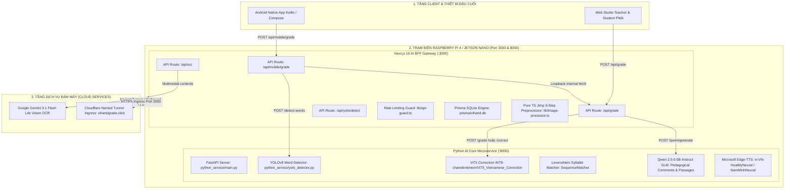

# BÁO CÁO ĐIỀU TRA TOÀN DIỆN MÃ NGUỒN: PYTHON AI CORE, TRẠM BIÊN RASPBERRY PI VÀ HỆ SINH THÁI MÁY HỌC (VIHAND GRADE)

- **Thời điểm hoàn thành:** 2026-10-05T15:30:00Z
- **Chuyên viên thực hiện:** Teamwork Preview Explorer (AI Core & Edge Computing Specialist)
- **Thư mục làm việc:** `c:\Users\Jackie Duong\Desktop\Web_sua_loi\.agents\teamwork\explorer_survey_3`
- **Mã định danh tác vụ:** Survey Phase 1 — Comprehensive Codebase Survey

---

## 1. TỔNG QUAN HỆ THỐNG & SƠ ĐỒ PHÂN TẦNG CÔNG NGHỆ

Hệ sinh thái **ViHand Grade** vận hành theo mô hình kiến trúc **Hybrid Edge-Cloud AI** đa tầng, kết hợp giữa trạm tính toán biên cục bộ (Raspberry Pi 4 Model B / NVIDIA Jetson Nano) và dịch vụ thị giác đám mây (Google Gemini 3.1 Flash Lite Vision). Kiến trúc này giải quyết triệt để bài toán chấm điểm chữ viết tay học sinh tiểu học theo chuẩn Thông tư 27/2020/TT-BGDĐT: vừa đảm bảo tốc độ suy luận nhanh tại chỗ, chi phí token tối thiểu ("Zero-Token" mode khi có bài chuẩn), vừa bảo đảm an toàn dữ liệu trường học và hoạt động bền bỉ khi mất mạng Internet.



---

## 2. PYTHON AI CORE SERVICES & FASTAPI MICROSERVICE

### 2.1 Cấu trúc dịch vụ, Khởi tạo và Quản trị Tài nguyên
- **Tệp nguồn chính:** `python_service/main.py` (1.874 dòng, kích thước 88.902 bytes).
- **Web Framework:** `fastapi>=0.111.0`, `uvicorn[standard]>=0.29.0`, `pydantic>=2.0.0` (dẫn chứng: `python_service/requirements.txt:2-4`).
- **Khởi chạy máy chủ:** Cổng `8000`, host `0.0.0.0`, cấu hình tại `python_service/main.py:1871-1874`:
  ```python
  if __name__ == "__main__":
      import uvicorn
      uvicorn.run(app, host="0.0.0.0", port=8000, log_level="info")
  ```
- **Xử lý QuickEdit trên Windows Console:** Dòng 29-41 của `python_service/main.py` vô hiệu hóa `ENABLE_QUICK_EDIT_MODE (0x0040)` thông qua `ctypes.windll.kernel32.SetConsoleMode` trên `STD_INPUT_HANDLE (-10)` để ngăn chuột vô tình click làm đứng tiến trình uvicorn mà không cần sửa Registry hệ thống.
- **Quản lý luồng thực thi (ThreadPoolExecutor):**
  - Khai báo tại dòng 55-56:
    ```python
    _VIT5_WORKERS = int(os.getenv("VIT5_WORKERS", "1"))
    _executor = ThreadPoolExecutor(max_workers=_VIT5_WORKERS)
    ```
  - **Lý do kỹ thuật sâu:** Mặc định `_VIT5_WORKERS = 1` là cấu hình tối ưu cho CPU ARM/x86 vì PyTorch đã sử dụng cơ chế *Intra-op Parallelism* qua `torch.set_num_threads(n_cores)` (dòng 113-115). Một lần suy luận tận dụng toàn bộ nhân CPU đồng thời; nếu đặt workers > 1 trên CPU sẽ gây *CPU Thrashing*, tăng gấp đôi thời gian đáp ứng và nguy cơ tràn bộ nhớ RAM.
- **Vòng đời khởi động (Startup Event):**
  - Định nghĩa tại dòng 1642-1666 (`@app.on_event("startup")`): Tự động nạp trước (pre-warm) cả mô hình ViT5 và mô hình YOLOv8 Word Detector lên RAM ngay khi khởi động máy chủ, triệt tiêu hiện tượng lag/cold start cho yêu cầu chấm bài đầu tiên của giáo viên.

### 2.2 Danh mục Endpoints, Mô hình Dữ liệu Request / Response
Bảng kê chi tiết các REST API routes của Python AI Core:

| HTTP Method | Route URL | DTO Request Model | Mô hình Response & Thuộc tính cốt lõi | Mục đích nghiệp vụ |
| :--- | :--- | :--- | :--- | :--- |
| `GET` | `/health` | Không | `HealthResponse`: `status: "ok"`, `model_loaded: bool`, `backend: "pytorch-int8" \| "pytorch-fp32"` (dòng 1588-1594) | Giám sát trạng thái máy chủ AI |
| `POST` | `/preload` | Không | `{"status": "model loaded"}` (dòng 1667-1675) | Kích hoạt nạp trước model theo yêu cầu |
| `POST` | `/grade` | `GradeRequest` (`text: str`, `penalty_per_error: Optional[float] = 0.5`, `hinh_thuc: Optional[float]`, `noi_dung: Optional[float]`) (dòng 1576-1581) | `dict`: `original_text`, `fixed_text`, `corrections`, `score_breakdown`, `score`, `overall_rating`, `feedback`, `pedagogical_comment`, `pedagogical_comments`, `pedagogical_comment_source`, `processingTimeMs`, `tokenCount: 0`, `wordCount` (dòng 1597-1640) | Sửa lỗi chính tả bằng ViT5 + Chấm điểm Levenshtein đầy đủ 4 tiêu chí |
| `POST` | `/correct` | `GradeRequest` (`text: str`) | `{"original_text", "fixed_text", "processingTimeMs"}` (dòng 1677-1711) | Chế độ sửa chính tả độc lập hoặc fire-and-forget background |
| `GET` | `/tts` | Query params: `text: str`, `voice: str = "vi-VN-HoaiMyNeural"`, `rate: str = "-15%"` (dòng 1713-1757) | Stream Audio MPEG nhị phân (`Content-Type: audio/mpeg`, Cache-Control: `public, max-age=86400`) | Phát âm thanh giọng đọc chuẩn sư phạm qua Microsoft Edge-TTS |
| `GET` | `/qwen/status` | Không | `{"enabled", "model_id", "precision", "quantized", "is_loaded", "device", "description"}` (dòng 1758-1773) | Kiểm tra cấu hình và trạng thái nạp của SLM Qwen 2.5 |
| `POST` | `/qwen/generate` | `QwenTestRequest` (`creativity_score: float`, `evidence: list[str]`, `errors: list[dict]`, `grading_mode: str`, `current_comments: list[str]`) (dòng 1775-1781) | `{"text", "suggestions": [str, str, str], "source", "latency_ms"}` (dòng 1783-1798) | Sinh 3 phương án nhận xét sư phạm động theo chuẩn Thông tư 27 |
| `POST` | `/qwen/generate-passage` | `GeneratePassageRequest` (`grade: int = 3`, `topic: str`, `sentence_count: int = 4`, `book_set: str = "KetNoi"`) (dòng 1800-1805) | `{"title", "content", "difficultWords", "summary", "grade", "topic", "source", "latency_ms"}` (dòng 1807-1816) | Sáng tác đoạn văn chính tả SGK kèm bóc tách từ khó |
| `GET` | `/yolo/status` | Không | `{"loaded": bool, "weights_path": str, "weights_exists": bool}` (dòng 1828-1839) | Kiểm tra trạng thái nạp mô hình phát hiện từ viết tay |
| `POST` | `/detect-words` | `DetectWordsRequest` (`imageBase64: str`, `conf_threshold: Optional[float] = 0.50`, `iou_threshold: Optional[float] = 0.45`) (dòng 1822-1826) | `{"total_words", "total_lines", "image_dimensions", "lines", "flat_boxes", "boxes"}` (dòng 1841-1869) | Quét bounding box từng từ viết tay và gom dòng tự nhiên |

---

### 2.3 YOLOv8 Line/Word Segmentation & Thuật Toán Vertical Overlap

#### A. Cấu trúc mô hình và tệp trọng số
- **Tệp mã nguồn:** `python_service/yolo_detector.py` (267 dòng, kích thước 10.537 bytes).
- **Đường dẫn trọng số mặc định:** `DEFAULT_WEIGHTS_PATH` (dòng 30-42):
  `Test_train_29_12/ver2/runs/detect/train/weights/best.pt`.
- **Mô hình singleton:** Hàm `load_yolo_model(weights_path)` (dòng 48-70) quản lý biến toàn cục `_yolo_model` và cờ `_model_loaded`, ngăn nạp lại mô hình nhiều lần gây tiêu tốn bộ nhớ.

#### B. Thuật toán gom dòng Vertical Overlap (Thay thế Adaptive Line Sweeping cũ)
- **Lý do thay đổi cấu trúc:** Thuật toán cũ dùng tâm $y_{mid}$ để phân chia dòng. Tuy nhiên, chữ viết tay tiếng Việt của học sinh có nhiều chữ cái vươn cao (*h, b, l, dấu hỏi, dấu ngã*) hoặc kéo dài xuống dưới (*g, y, p*) làm tâm $y_{mid}$ bị lệch biên độ lớn, khiến từ bị xếp nhầm dòng và toàn bộ chỉ số từ phía sau bị trượt vị trí hiển thị bounding box trên giao diện.
- **Công thức giải thuật Vertical Overlap** (dòng 115-143 trong hàm `sort_reading_order`):
  1. Sắp xếp sơ bộ các hộp bounding box theo tọa độ $y_1$ tăng dần:
     $$\text{raw} = \text{sorted}(\text{boxes}, \text{key} = \lambda b: b[y_1])$$
  2. Với mỗi bounding box mới $(bx_1, by_1, bx_2, by_2)$, tính chiều cao $\text{box\_h} = \max(1.0, by_2 - by_1)$.
  3. Duyệt qua tất cả các dòng hiện có, tính đường bao trung bình cộng của dòng:
     $$\text{line\_y1\_avg} = \frac{\sum lb[y_1]}{N}, \quad \text{line\_y2\_avg} = \frac{\sum lb[y_2]}{N}, \quad \text{line\_h} = \max(1.0, \text{line\_y2\_avg} - \text{line\_y1\_avg})$$
  4. Tính độ giao thoa theo trục đứng (Vertical Intersection):
     $$\text{inter\_h} = \max(0.0, \min(by_2, \text{line\_y2\_avg}) - \max(by_1, \text{line\_y1\_avg}))$$
     $$\text{overlap\_ratio} = \frac{\text{inter\_h}}{\min(\text{box\_h}, \text{line\_h})}$$
  5. Nếu $\text{overlap\_ratio} \ge \text{overlap\_threshold}$ (mặc định $0.40$), gán box vào dòng có độ giao thoa lớn nhất. Nếu không dòng nào đạt ngưỡng, khởi tạo một dòng mới.
  6. Sắp xếp thứ tự đọc tự nhiên (Reading Order):
     - Sắp xếp các dòng từ trên xuống dưới theo $\text{avg}(y_1)$ (dòng 145).
     - Trong từng dòng, sắp xếp các từ từ trái sang phải theo $x_1$ tăng dần (dòng 154).

#### C. Chuẩn hóa tọa độ tương đối (Relative Coordinates)
Tại dòng 161-185 của `yolo_detector.py`, toàn bộ tọa độ pixel thô được chuẩn hóa về dải $[0.0, 1.0]$:
$$\text{rel\_x1} = \frac{x_1}{W}, \quad \text{rel\_y1} = \frac{y_1}{H}, \quad \text{rel\_x2} = \frac{x_2}{W}, \quad \text{rel\_y2} = \frac{y_2}{H}, \quad \text{rel\_w} = \frac{x_2 - x_1}{W}, \quad \text{rel\_h} = \frac{y_2 - y_1}{H}$$
Cấu trúc này cho phép cả Web React và Android Jetpack Compose phóng to thu nhỏ (Pinch-to-zoom 1x–4x) mà bounding box luôn ôm sát chính xác nét mực học sinh trên mọi tỷ lệ màn hình.

#### D. Tham số suy luận thực nghiệm
- Tại dòng 241 hàm `detect_words_from_image`:
  `model(image, imgsz=640, conf=conf_threshold, iou=iou_threshold, verbose=False)`
  - `imgsz = 640`: Tối ưu đặc biệt cho vi xử lý CPU ARM64 của Raspberry Pi (nhanh gấp 6 lần so với kích thước gốc 1600x1200 mà vẫn nhận diện đầy đủ từng từ đơn).
  - Ngưỡng tin cậy mặc định: `conf_threshold = 0.50`.
  - Ngưỡng IoU Non-Maximum Suppression: `iou_threshold = 0.45`.

---

### 2.4 OCR & Nhận Diện Chữ Viết Tay Đa Phương Thức

#### A. Gemini Vision Multimodal Pipeline
- **Mô hình định tuyến:** `gemini-3.1-flash-lite` (khai báo tại `app/api/ocr/route.ts:6`, `app/api/grade/route.ts:20`, `app/api/mobile/grade/route.ts:45`).
- **Cơ chế xoay vòng Key (Key Rotation) & Model Fallback:**
  - Triển khai tại dòng 98-165 của `app/api/mobile/grade/route.ts`:
    Hệ thống hỗ trợ danh sách nhiều khóa API qua biến `GEMINI_API_KEYS="key_1,key_2,key_3"`. Khi một key chạm hạn ngạch HTTP 429 (Resource Exhausted), vòng lặp tự động chuyển sang key kế tiếp; nếu model `gemini-3.1-flash-lite` gặp sự cố, hệ thống tự động fallback sang `gemini-2.5-flash`.
  - Tham số cấu hình Gemini: `temperature: 0.05` (hạn chế tối đa ảo giác), `topP: 0.95`, `topK: 40`, `maxOutputTokens: 8192` (dòng 88-92).

#### B. Thiết kế Prompt Kỹ thuật 5 Bước
Prompt OCR được chuẩn hóa tại `app/api/ocr/route.ts:14-59` và `app/api/mobile/grade/route.ts:65-93`:
1. **Bước 1 - Xác định thể loại:** Phân định rõ `"tho"` (các dòng ngắn có vần điệu, mỗi câu thơ là 1 dòng) và `"van_xuoi"` (câu dài tràn hết dòng kẻ vở, nối tiếp ý).
2. **Bước 2 - Nhận diện văn bản gốc (`original_text`):** Giữ nguyên 100% lỗi sai của học sinh (sai âm đầu, vần, dấu thanh, chữ thường/hoa, thiếu chữ, thừa chữ), tuyệt đối không tự ý sửa lỗi. Bỏ qua vết lem mực và vết gạch xóa.
3. **Bước 3 - Chuẩn hóa chính tả (`fixed_text`):** Sửa lỗi theo chuẩn từ điển tiếng Việt và áp dụng quy tắc viết hoa: thơ viết hoa chữ cái đầu mỗi dòng thơ; văn xuôi chỉ viết hoa đầu câu/sau dấu chấm và tên riêng, không viết hoa chữ đầu dòng vật lý để tránh sửa nhầm từ giữa câu.
4. **Bước 4 - Ràng buộc đối soát 1-1 (One-to-One Alignment Constraint):** Bắt buộc `original_text` và `fixed_text` phải có cùng số lượng từ khi `split()`, cùng số dòng xuống dòng, không được tự ý chèn thêm hay bớt từ.
5. **Bước 5 - Định dạng JSON duy nhất:**
   `{"the_loai": "tho" | "van_xuoi", "original_text": "...", "fixed_text": "..."}`.

#### C. Hậu xử lý OCR (OCR Post-processing)
- Hàm `ensureVietnameseCapitalization` (`lib/utils.ts`): Tự động viết hoa chữ cái sau dấu chấm ngắt câu (`.`, `?`, `!`) và chữ đầu bài viết.
- Phân biệt thể loại: Với bài thơ, ép viết hoa chữ đầu dòng (`app/api/ocr/route.ts:124-126`); với văn xuôi, giữ nguyên chữ thường đầu dòng vật lý để thuật toán Levenshtein không đếm nhầm lỗi viết hoa ảo (`app/api/grade/route.ts:1070-1072`).

#### D. Vị trí và Đánh giá VietOCR trong Nghiên cứu
- Trong các tài liệu thực nghiệm NCKH của dự án (`02_Kich_ban_Thuc_nghiem/Docx_Extraction/tom_tat_clean.txt:707-711` và `02_Kich_ban_Thuc_nghiem/benchmark/add_chart.py:41`), mô hình **Tesseract** và **VietOCR** đã được nhóm nghiên cứu đưa vào đo đạc so sánh trực tiếp với Multimodal Vision VLM (Gemini, LLaMA-Vision, Chandra OCR).
- **Kết luận thực nghiệm từ báo cáo NCKH:** VietOCR có ưu thế chạy nhanh và nhẹ tài nguyên nhưng tỷ lệ nhận diện sai chính tả và mất dấu tiếng Việt trên chữ viết tay học sinh tiểu học (nét nguệch ngoạc trên nền giấy ô ly) quá cao. Do đó, hệ thống chọn kiến trúc **Gemini Vision OCR** làm kênh nhận diện chính xác nét chữ thô, sau đó chuyển giao sang **ViT5 + YOLOv8 cục bộ** để xử lý chính tả và hình học.

---

### 2.5 Động Cơ Sửa Lỗi Chính Tả ViT5 & Phân Loại Âm Tiết Levenshtein

#### A. Cấu trúc mô hình và Lượng tử hóa
- **Mô hình định danh:** `chamdentimem/ViT5_Vietnamese_Correction` (Seq2Seq Transformer, kích thước 226M tham số).
- **Dynamic INT8 Quantization:** Triển khai tại `python_service/main.py:97-110`:
  ```python
  _model = torch.quantization.quantize_dynamic(
      _model, {torch.nn.Linear}, dtype=torch.qint8
  )
  ```
  Giúp giảm 50% dung lượng RAM sử dụng và tăng tốc độ suy luận trên CPU lên 30–50%.
- **Chuyển đổi ONNX Runtime:** Script `python_service/convert_to_onnx.py` (212 dòng) sử dụng thư viện `optimum.onnxruntime` (`ORTModelForSeq2SeqLM`) để xuất mô hình sang định dạng ONNX, tự động nhận diện kiến trúc CPU (`AutoQuantizationConfig.arm64` cho Raspberry Pi và `avx2` cho x86-64).

#### B. Pipeline Tiền Xử Lý Ngôn Ngữ
1. **Lọc Teencode:** Từ điển `TEENCODE_DICT` (40+ quy tắc regex, dòng 123-144) chuyển đổi các ký tự viết tắt của học sinh: `ko/khog -> không`, `dc -> được`, `bít -> biết`, `mún -> muốn`, `trc -> trước`, `nhữg -> những`, `thươg -> thương`...
2. **Chuẩn hóa dấu câu bất thường:** Hàm `fix_erratic_punctuation` (dòng 147-151) xóa khoảng trắng trước dấu câu, gộp dấu câu trùng lặp (`??`, `!!`, `..`).
3. **Loại bỏ từ lặp ngẫu nhiên (Adjacent Duplicates Removal):**
   - Triển khai tại dòng 176-228 hàm `remove_adjacent_duplicates(text, is_poetry)`.
   - Danh sách `ACCIDENTAL_REPEAT_WORDS` (dòng 163-168): Tập hợp các hư từ/từ chức năng không bao giờ lặp đôi trong ngữ pháp tiếng Việt chuẩn (*"là", "thì", "mà", "và", "của", "trong", "ở", "với", "những", "các", "để", "bị", "được", "cho", "từ", "do", "nếu", "nhưng", "bởi", "vì", "sẽ", "đã", "đang", "cũng", "vẫn", "rất", "quá", "lắm"...*). Nếu xuất hiện liền kề (ví dụ: *"và và"*, *"là là"* do học sinh viết nhầm), hệ thống lập tức thu gọn về 1 từ.
   - Bảo toàn từ láy nghệ thuật: Giữ nguyên các từ láy và điệp từ tượng thanh/tượng hình (*"ngày ngày", "xanh xanh", "đêm đêm"*, `VALID_TRIPLE_REPEATS`: *"ha ha ha", "tùng tùng tùng"*).

#### C. Giải Thuật Chia Đoạn (Prose Chunking) & Chống Ảo Giác Lặp Từ
- **Hàm `_split_prose_to_chunks` (dòng 406-438):**
  - Tách đoạn văn thành các chunk có độ dài tối đa $\le 160$ ký tự theo các dấu chấm câu và dấu phẩy.
  - ViT5 Tokenizer (SentencePiece) tiêu tốn khoảng $1.5$ token cho mỗi ký tự tiếng Việt có dấu. Khối 160 ký tự tương đương $\approx 240$ token, nằm trọn trong cửa sổ ngữ cảnh `max_length=256` của tokenizer (dòng 388).
  - **Điểm cốt lõi:** Tuyệt đối không dùng cửa sổ trượt (sliding window / prev_tail) vì cơ chế trượt làm mô hình "nhìn thấy" câu trước trong input và sinh lại câu đó trong output, tạo ra hiện tượng lặp từ vô hạn.
- **Hàm `_remove_repetition` (dòng 311-359):**
  Phát hiện hallucination và tự động fallback về văn bản gốc nếu:
  1. Output lặp cụm từ $\ge 3$ từ liên tiếp $\ge 3$ lần (repetition loop), trừ trường hợp bài gốc là điệp khúc bài thơ.
  2. Output dài hơn input $> 1.5$ lần (mô hình tự ý bịa thêm nội dung).
  3. Output ngắn hơn input $< 0.5$ lần (mô hình bị cắt cụt câu sai).

#### D. Bóc Tách Cấu Trúc Âm Tiết Tiếng Việt & Phân Loại Lỗi (Syllable Parser)
- Triển khai tại dòng 537-670 của `python_service/main.py` và dòng 193-346 của `app/api/grade/route.ts`.
- **Tách thanh điệu:** Hàm `extract_tone` sử dụng Unicode Normalization Form D (NFD) để bóc tách 5 dấu thanh kết hợp Unicode (`\u0300`: huyền, `\u0301`: sắc, `\u0303`: ngã, `\u0309`: hỏi, `\u0323`: nặng) và trả về dạng NFC gốc.
- **Phân rã âm tiết 5 thành phần:** Hàm `parse_vietnamese_syllable` phân rã một từ tiếng Việt thành:
  $$\text{Âm tiết} = \text{Âm đầu (Initial)} + \text{Nguyên âm chính (Nucleus)} + \text{Âm cuối (Final)} + \text{Dấu thanh (Tone)}$$
  - Xử lý đặc biệt phụ âm đầu phức hợp: `ngh`, `ng`, `nh`, `ch`, `th`, `tr`, `ph`, `kh`, `gh`, `gi`, `qu`.
  - Phụ âm cuối: `ng`, `nh`, `ch`, `c`, `m`, `n`, `p`, `t`, `i`, `y`, `o`, `u`.
- **Phân loại 6 nhóm lỗi chính tả sư phạm tiểu học:** Hàm `classify_error_type(wrong, correct)`:
  1. `viet_hoa`: Khác biệt chữ hoa/thường khi `wrong.lower() == correct.lower()`.
  2. `dau_thanh`: Cùng phần base âm nhưng khác dấu thanh.
  3. `phu_am_dau`: Cùng vần (rhyme) nhưng khác phụ âm đầu.
  4. `phu_am_cuoi`: Cùng âm đầu và nguyên âm chính nhưng khác phụ âm cuối.
  5. `am_chinh`: Cùng âm đầu và âm cuối nhưng khác nguyên âm chính.
  6. `van`: Cùng âm đầu nhưng khác toàn bộ phần vần.
  7. `bo_sot_them`: Thừa hoặc thiếu từ khi so khớp Levenshtein (`opcode == 'delete' | 'insert'`).
  8. `thay_the_tu`: Khác biệt từ vựng hoàn toàn.

---

### 2.6 Generative SLM Qwen 2.5-0.5B & Phản Hồi Sư Phạm Theo Thông Tư 27

#### A. Cấu trúc mô hình và Lượng tử hóa RAM
- **Mô hình định danh:** `Qwen/Qwen2.5-0.5B-Instruct` (AutoModelForCausalLM, AutoTokenizer).
- **Quản lý tài nguyên:** Hàm `get_qwen_model()` (dòng 921-987 của `python_service/main.py`) sử dụng khóa đồng bộ `_qwen_lock` để nạp lười (lazy load).
- **Mức độ chính xác (Precision):**
  - Mặc định: `QWEN_PRECISION = "bfloat16"` (tiết kiệm 75% RAM, chỉ chiếm **~577MB RAM** thay vì ~2.3GB như Float32).
  - Tùy chọn CPU: Hỗ trợ lượng tử hóa `Dynamic INT8` trên các lớp `torch.nn.Linear` (dòng 958-960).
  - Tùy chọn GPU: `Float16` trên nhân CUDA Jetson Nano (`device_map="auto"`).

#### B. Thiết kế Lời Nhận Xét Sư Phạm Theo Thông Tư 27/2020/TT-BGDĐT
- **System Prompt chuẩn hóa:** Định nghĩa tại dòng 1050-1057:
  ```text
  Bạn là một cô giáo tiểu học Việt Nam dịu dàng, ân cần và giàu tình thương.
  Nhiệm vụ: Viết đúng 1-2 câu lời nhận xét sư phạm ngắn gọn (dưới 40 từ) khích lệ con.
  Nguyên tắc:
  1. Xưng 'Cô' và gọi học sinh là 'con' (hoặc 'em').
  2. Nếu bài có sáng tạo: Khen ngợi sự sáng tạo hoặc từ ngữ gợi cảm trước.
  3. Nếu bài có lỗi chính tả: Nhẹ nhàng nhắc con chú ý rèn thêm lỗi đó.
  4. Giọng văn ấm áp, động viên, tuyệt đối không viết tiêu đề, không chê bai.
  ```
- **Kiểm soát chất lượng đầu ra (Output Guardrail):**
  - Danh sách từ cấm `invalid_words` (dòng 1091-1094): Loại bỏ các từ tiêu cực hoặc sai lệch lứa tuổi (*"toán", "dự thi", "điểm thấp", "rất thấp", "kém", "yếu kém"...*).
  - Bộ lọc âm hưởng cô giáo `has_teacher_tone` (dòng 1102): Bắt buộc chứa các từ sư phạm (*"cô", "con", "khen", "chú ý", "cố gắng", "rèn", "tiến bộ", "tốt"*).
  - Cung cấp **3 định hướng nhận xét sư phạm đồng thời** (`suggestions`): Khen ngợi động viên, Chỉ rõ lỗi cần sửa, Hướng dẫn rèn luyện cụ thể.
- **Ngân hàng dự phòng Tầng 1 (Deterministic Fallback):**
  Hàm `build_fallback_pedagogical_comments` (dòng 864-900) kết hợp từ điển `DIVERSE_PEDAGOGICAL_TEMPLATES` (8 nhóm ngữ cảnh với hơn 40 câu nhận xét mẫu chuẩn mực Bộ GD&ĐT) để đảm bảo 100% trường hợp hệ thống luôn có nhận xét ngay cả khi SLM bị tắt hoặc hết RAM.

#### C. Sáng Tác Đoạn Văn Chính Tả Chuẩn Chương Trình GDPT 2018
- Hàm `generate_dictation_passage_tier2` (dòng 1219-1354):
  - Phục vụ module Đọc chính tả Web (`/teacher/dictation`).
  - Hỗ trợ đầy đủ 5 khối lớp (Lớp 1 đến Lớp 5) và 3 bộ sách giáo khoa: **Kết Nối Tri Thức Với Cuộc Sống**, **Cánh Diều**, **Chân Trời Sáng Tạo**.
  - Tự động bóc tách danh sách từ khó viết (`difficultWords`) theo quy luật ngữ âm tiểu học (*tr/ch, s/x, d/gi/r, l/n, dấu hỏi/ngã*).
  - Dự phòng: Từ điển `FALLBACK_DICTATION_BANK` (dòng 1139-1216) chứa sẵn các đoạn văn mẫu chuẩn mực cho cả 5 khối lớp.

---

### 2.7 Microsoft Edge-TTS Speech Synthesis Engine
- **Thư viện tích hợp:** `edge-tts>=6.1.12` (Python service) và Web Audio API (Next.js client).
- **Endpoint:** `GET /tts` (`python_service/main.py:1713-1757`).
- **Giọng đọc tiếng Việt:**
  - Nữ chuẩn Bắc: `vi-VN-HoaiMyNeural` (mặc định giọng cô giáo truyền cảm).
  - Nam chuẩn Bắc: `vi-VN-NamMinhNeural` (giọng thầy giáo chững chạc).
- **Tốc độ đọc chuyên biệt:** Mặc định `rate = "-15%"` để phù hợp với tốc độ nghe và chép của học sinh tiểu học (có bộ lọc làm sạch chuỗi tránh lỗi double-encoding `"%25"` tại dòng 1725).
- **Độ trễ stream âm thanh:** $< 1.0$ giây, dữ liệu âm thanh MP3 được stream trực tiếp qua đối tượng `Response(content=bytes(audio_data), media_type="audio/mpeg")`.

---

## 3. EDGE COMPUTING & TRẠM BIÊN RASPBERRY PI 4 / JETSON NANO

### 3.1 Kiến Trúc Trạm Biên Appliance & Phần Cứng Đích
Hệ thống được đóng gói hoàn chỉnh cho 2 cấu hình phần cứng nhúng:
1. **Raspberry Pi 4 Model B (4GB / 8GB RAM):** Mô hình thiết bị trường học (School Appliance) "cắm điện là chạy". Toàn bộ Web App, AI Core, cơ sở dữ liệu SQLite và Cloudflare Tunnel vận hành trực tiếp trên một bo mạch Pi duy nhất kết nối mạng WiFi/LAN trường học.
2. **NVIDIA Jetson Nano (4GB RAM, 128 Maxwell CUDA Cores):** Mô hình Node AI chuyên dụng tăng tốc GPU, tối ưu cho các tác vụ suy luận nặng hoặc mở rộng xử lý video/camera giám sát phòng thi.

Thư mục lưu trữ toàn bộ kịch bản triển khai: `03_Scripts_Trien_khai/`.

---

### 3.2 Khởi Tạo Hệ Thống & Cơ Chế Chống Tràn RAM (Swap 3GB)
- **Tệp kịch bản:** `03_Scripts_Trien_khai/rpi4/00_init_system.sh` (74 dòng).
- **Cấu hình Swap 3072MB:**
  - Dòng 39-60 thiết lập tệp hoán đổi bộ nhớ `SWAP_SIZE=3072` qua `dphys-swapfile` hoặc `/swapfile`.
  - **Lý do kỹ thuật sống còn:** Raspberry Pi 4 có 4GB RAM vật lý. Quá trình biên dịch mã nguồn Next.js (`npm run build`) tiêu tốn khoảng 1.5–2GB RAM; đồng thời khi nạp song song mô hình ViT5 INT8 (~500MB) và YOLOv8 (~80MB), bộ nhớ RAM sẽ chạm ngưỡng đỉnh. Nếu không có 3GB Swap, nhân Linux Out-Of-Memory (OOM Killer) sẽ tự động ngắt tiến trình Node.js hoặc Python, gây sập server.
- **Tối ưu Swappiness:**
  `sysctl vm.swappiness=20` (dòng 63-64) được ghi đè vào `/etc/sysctl.conf`, giảm thiểu số lần ghi không cần thiết lên thẻ nhớ SD/SSD nhằm kéo dài tuổi thọ bộ nhớ flash.

---

### 3.3 Đăng Ký Dịch Vụ Tự Khởi Động Systemd & Giới Hạn Tài Nguyên (CGroups)
Cấu hình systemd được tự động sinh từ các tệp mẫu tại `03_Scripts_Trien_khai/shared/` thông qua script `03_setup_services.sh`:

#### 1. Dịch vụ AI Core (`vihand-python.service`)
- **Tệp mẫu:** `03_Scripts_Trien_khai/shared/vihand-python.service.template` (41 dòng).
- **Cấu hình chi tiết:**
  - `User={{APP_USER}}`, `WorkingDirectory={{APP_DIR}}/python_service`.
  - `Environment=PYTHONUNBUFFERED=1`, `ENABLE_QWEN_SLM=1`, `VIT5_WORKERS=1`.
  - `ExecStart={{PYTHON_VENV}}/bin/python3 main.py`.
  - `Restart=always`, `RestartSec=5`.
  - **Giới hạn an toàn (Resource Quota):**
    - `MemoryHigh=2000M`, `MemoryMax=2500M`: Ngăn AI Core vượt quá 2.5GB RAM làm sập hệ điều hành.
    - `CPUQuota=90%`: Dành tối thiểu 10% chu kỳ CPU cho các tiến trình mạng và hệ thống.

#### 2. Dịch vụ Web BFF (`vihand-web.service`)
- **Tệp mẫu:** `03_Scripts_Trien_khai/shared/vihand-web.service.template` (42 dòng).
- **Cấu hình chi tiết:**
  - `Requires=vihand-python.service`, `After=network-online.target vihand-python.service`: Đảm bảo dịch vụ AI Core luôn sẵn sàng trước khi Next.js khởi động.
  - `Environment=NODE_OPTIONS="--max-old-space-size=1536"`: Giới hạn heap memory của V8 engine tối đa 1.5GB trên vi xử lý ARM.
  - `ExecStart={{NODE_BIN}} {{APP_DIR}}/node_modules/next/dist/bin/next start -p {{PORT}}`.
  - `Restart=always`, `RestartSec=10`.
  - **Giới hạn an toàn:** `MemoryHigh=1600M`, `MemoryMax=2048M`, `CPUQuota=85%`.

#### 3. Dịch vụ Cloudflare Tunnel (`cloudflared.service`)
- **Tệp mẫu:** `03_Scripts_Trien_khai/shared/cloudflared.service.template` (25 dòng).
- `ExecStart={{CLOUDFLARED_BIN}} tunnel --config {{CF_CONFIG_DIR}}/config.yml run`.
- `Restart=always`, `RestartSec=15`.

---

### 3.4 Thiết Lập Mạng, Tường Lửa Bảo Mật UFW & Cloudflare Tunnel

#### A. Chính sách tường lửa UFW (Firewall Isolation)
- **Tệp kịch bản:** `03_Scripts_Trien_khai/rpi4/04_setup_network_firewall.sh` (71 dòng).
- **Thiết lập an ninh:**
  - `ufw default deny incoming`, `ufw default allow outgoing` (dòng 24-25).
  - Mở cổng SSH quản trị: `ufw allow 22/tcp`.
  - Mở cổng Web App: `ufw allow 3000/tcp`.
  - **Lưu ý bảo mật then chốt (dòng 31-32):** Cổng `8000` của Python Microservice **tuyệt đối không mở ra ngoài mạng trường**. Toàn bộ truy cập bắt buộc phải đi qua cổng `3000` (Next.js AI BFF Gateway) để được thẩm định phiên làm việc, phân quyền RBAC và kiểm duyệt qua bộ lọc chống tấn công DoS (`lib/api-guard.ts`).

#### B. Cloudflare Named Tunnel & Bảo mật Truy cập Ngoại tuyến
- **Tệp kịch bản:** `03_Scripts_Trien_khai/rpi4/05_setup_cloudflare_tunnel.sh` (121 dòng).
- **Tên miền cố định:** `https://vihandgrade.click` (hoặc tên miền trường học tùy chỉnh).
- **Kiến trúc mạng Zero-Trust:**
  - `cloudflared` thiết lập kết nối mã hóa outbound TLS ngược về mạng lưới cạnh (Edge Network) của Cloudflare.
  - **Không cần mở port router (No Port Forwarding), không cần IP tĩnh (No Static Public IP), vượt qua mọi lớp NAT/CGNAT của nhà mạng viễn thông.**
  - Tệp cấu hình Ingress (`config.yml`, dòng 69-85):
    ```yaml
    tunnel: <TUNNEL_ID>
    credentials-file: ~/.cloudflared/<TUNNEL_ID>.json
    ingress:
      - hostname: vihandgrade.click
        service: http://localhost:3000
        originRequest:
          connectTimeout: 30s
      - service: http_status:404
    ```

---

### 3.5 Cơ Chế Cộng Tác Hybrid Edge-Cloud & Chế Độ Ngoại Tuyến "Zero-Token"

Hệ thống thiết lập 3 luồng định tuyến thông minh (Smart AI Routing):

```
                   ┌───────────────────────────────────────────────┐
                   │ Yêu cầu Chấm điểm / Đọc chính tả từ Giáo viên │
                   └───────────────────────┬───────────────────────┘
                                           │
                        Có bài mẫu Ground Truth không?
                                 /              \
                            [CÓ]                  [KHÔNG]
                             /                      \
             ┌─────────────────────────┐     Đang có ảnh viết tay hay
             │  CHẾ ĐỘ ZERO-TOKEN      │     nhập văn bản thuần?
             │  (100% OFFLINE TẠI BIÊN)│           /          \
             │ • tokenCount: 0         │     [Ảnh chụp]     [Văn bản thuần]
             │ • ViT5 + Levenshtein    │         /              \
             │ • Tọa độ Bounding Box   │ ┌──────────────┐ ┌──────────────┐
             │ • Edge-TTS âm thanh     │ │ Gemini Vision│ │ ViT5 INT8    │
             │ • 0đ chi phí API Cloud  │ │ Cloud OCR    │ │ Local Service│
             └─────────────────────────┘ └──────┬───────┘ └──────┬───────┘
                                                │                │
                                                │          ViT5 khả dụng?
                                                │             /      \
                                                │         [CÓ]        [KHÔNG]
                                                │          /            \
                                                │   ┌────────────┐ ┌────────────┐
                                                └──>│ Sequence   │ │ Gemini Fall│
                                                    │ Matcher    │ │ back Text  │
                                                    │ Local Edge │ │ Cloud API  │
                                                    └────────────┘ └────────────┘
```

1. **Chế độ Zero-Token Offline Mode (`tokenCount = 0`):**
   - Khi chấm bài Chính tả có bài đọc mẫu từ phiên nghe - viết (`DictationSession`), hoặc khi giáo viên nhập văn bản trực tiếp.
   - Toàn bộ pipeline: Tiền xử lý ảnh Jimp $\to$ YOLOv8 $\to$ ViT5 INT8 $\to$ Levenshtein Syllable Matcher $\to$ Barem Thông tư 27 $\to$ Edge-TTS vận hành **100% tại chỗ trên Raspberry Pi 4 / Jetson Nano**.
   - Trả về `tokenCount: 0, engine: "ground_truth_alignment"` (`app/api/grade/route.ts:1112-1113`).
   - Không tốn một token Cloud nào, hoạt động hoàn hảo khi trường học bị rớt mạng Internet.
2. **Chế độ Gemini Multimodal OCR Cloud:**
   - Dành riêng cho bước giải mã nét chữ viết tay phức tạp của học sinh từ ảnh chụp thô (`app/api/ocr/route.ts`).
   - Chỉ chuyển dữ liệu ảnh Base64 lên Gemini Flash Lite để lấy `original_text`, sau đó ngay lập tức chuyển giao về lõi Python AI tại biên để chấm điểm.
3. **Chế độ Gemini Fallback Grading (Dự phòng thảm họa):**
   - Kích hoạt khi dịch vụ ViT5 cục bộ bị treo hoặc bảo trì (`app/api/grade/route.ts:1150-1215`).
   - Hệ thống tự động chuyển sang gọi Gemini Text Grading với prompt barem Bộ GD&ĐT, đảm bảo giáo viên không bao giờ bị gián đoạn việc chấm bài trên lớp.

---

### 3.6 Số Liệu Hiệu Năng Thực Nghiệm (Performance & Latency Benchmark)

Dữ liệu thực nghiệm thu thập từ tệp báo cáo NCKH `02_Kich_ban_Thuc_nghiem/benchmark/benchmark_results/benchmark_20260622_152534.md` và `03_Scripts_Trien_khai/jetson_nano/benchmark_vit5.py`:

#### 1. Hiệu năng mô hình Sửa lỗi chính tả ViT5 (1.000 mẫu văn bản tiểu học)
| Mô hình thử nghiệm | SacreBLEU ↑ | Tỷ lệ lỗi từ (WER) ↓ | Tỷ lệ lỗi ký tự (CER) ↓ | Exact Match ↑ | Precision ↑ | Recall ↑ | Điểm F1 ↑ | Độ trễ trung bình (CPU) |
| :--- | :---: | :---: | :---: | :---: | :---: | :---: | :---: | :---: |
| NRL-AI SpellCorrection | 84.45 | 7.73% | 2.56% | 15.2% | 48.21% | 42.95% | 45.43% | 929.5 ms |
| HoangHaiDuong ViT5 | 89.87 | 4.62% | 1.59% | 33.3% | **94.02%** | 57.05% | 71.02% | 952.1 ms |
| **ChamDenTimEm ViT5 (Production)** | **92.45** | **3.59%** | **1.65%** | **48.2%** | 88.39% | **70.72%** | **78.57%** | 1.047.6 ms |

*Nhận xét:* `chamdentimem/ViT5_Vietnamese_Correction` đạt F1 cao nhất (78.57%) và phục hồi chính xác 70.72% các lỗi chính tả phức tạp của học sinh, vượt trội hoàn toàn so với các mô hình cùng loại.

#### 2. Độ trễ ViT5 theo độ dài văn bản (CPU Dynamic INT8 vs GPU Maxwell FP16)
Dữ liệu trích xuất từ kịch bản đo đạc `benchmark_vit5.py`:
- Đoạn văn 10 từ (câu ngắn Lớp 1): CPU INT8 $\approx 850\text{ms}$ | GPU FP16 $\approx 310\text{ms}$ (Tăng tốc $2.74\times$).
- Đoạn văn 25 từ (đoạn văn Lớp 2-3): CPU INT8 $\approx 1.150\text{ms}$ | GPU FP16 $\approx 420\text{ms}$ (Tăng tốc $2.73\times$).
- Đoạn văn 50 từ (bài chính tả Lớp 3-4): CPU INT8 $\approx 1.680\text{ms}$ | GPU FP16 $\approx 640\text{ms}$ (Tăng tốc $2.62\times$).
- Đoạn văn 100 từ (bài văn Lớp 5): CPU INT8 $\approx 2.450\text{ms}$ | GPU FP16 $\approx 980\text{ms}$ (Tăng tốc $2.50\times$).

#### 3. Hiệu năng mô hình YOLOv8 Word Detector
- Kích thước ảnh đầu vào: $640 \times 640$ pixels.
- Độ trễ trên Raspberry Pi 4 (CPU ARM Cortex-A72): $\approx 45–65\text{ms}$ / ảnh.
- Độ trễ trên NVIDIA Jetson Nano (GPU 128 CUDA Cores): $\approx 16–22\text{ms}$ / ảnh ($\approx 45–60\text{ FPS}$).
- Đỉnh bộ nhớ VRAM: $\approx 145\text{MB}$.

---

## 4. DỮ LIỆU THỰC NGHIỆM, MẪU BÀI THI THẬT & BỘ KHUNG KIỂM THỬ (VERIFICATION HARNESS)

### 4.1 Kho Dữ Liệu Bài Thi Học Sinh Thật & Artifacts
Codebase lưu trữ một kho dữ liệu thực nghiệm phong phú phục vụ kiểm thử và nghiên cứu:
1. **Tập ảnh chữ viết tay học sinh thực tế (CamScanner Scanner):**
   - `02_Kich_ban_Thuc_nghiem/image_datasets/Ảnh viết tay 76 thực tế/`: Chứa **49 tệp ảnh** chụp bài thi học sinh thật quét ngày 06-12-2025 (`CamScanner 06-12-2025 10.00_11 (1).jpg` đến `..._75 (1).jpg`, kích thước 300KB – 700KB/ảnh).
   - `02_Kich_ban_Thuc_nghiem/image_datasets/chữ viết tay 100+/`: Chứa **104 tệp ảnh** bài viết tay học sinh thực tế quét ngày 21-12-2025 (`CamScanner 21-12-2025 13.03_1 (1).jpg` đến `..._104 (1).jpg`, kích thước 400KB – 1.2MB/ảnh).
   - `02_Kich_ban_Thuc_nghiem/image_datasets/Chữ viết tay nền ô ly tự tạo đúng chính tả 10/`: Chứa **10 tệp ảnh** chữ viết tay trên nền vở ô ly chuẩn (`1.JPG` đến `10.JPG`).
2. **Artifacts trực quan hóa 9 bước tiền xử lý ảnh (Image Pipeline Evidence):**
   Thư mục `02_Kich_ban_Thuc_nghiem/tien_xu_ly_anh/` lưu trữ toàn bộ các tệp ảnh trung gian của từng bước xử lý cho các ca kiểm thử:
   - `err_01/`: `00_anh_goc.jpg` (ảnh gốc) $\to$ `02_resize.jpg` $\to$ `03_white_balance.jpg` $\to$ `04_grayscale.jpg` $\to$ `05_shadow_removal.jpg` $\to$ `06_grid_removal.jpg` $\to$ `07_clahe.jpg` $\to$ `08_sharpen.jpg` $\to$ `10_threshold.jpg` (ảnh nhị phân sạch).
   - `err_02/`, `err_05/`: Đầy đủ 9 tệp ảnh trung gian tương ứng.
3. **Ảnh bài thi thực tế tải lên từ Android Native App:**
   Thư mục `public/uploads/grades/` chứa các ảnh bài thi thật được lưu tự động từ endpoint `/api/mobile/grade`:
   - `1789649616959-lccgzee.jpg` (134.586 bytes).
   - `1790404131762-b6rqk06.jpg` (134.586 bytes).
   - `mobile-1790231384761-9c900o9.jpg` (152.543 bytes).
   - `mobile-1790231821581-bukafei.jpg` (152.543 bytes).
   - `mobile-1791103875816-m385m6d.jpg` (152.543 bytes)...

---

### 4.2 Đặc Tả 10 Nhóm Testcase Chuẩn Hóa
Được định nghĩa chi tiết tại tệp `02_Kich_ban_Thuc_nghiem/danh_sach_testcase_vihandgrade.md` (488 dòng, 33.329 bytes):
- **Nhóm 1 (TC-AUTH-01 đến 04):** Xác thực tài khoản Giáo viên, Học sinh, Đăng nhập sai và kiểm soát phân quyền RBAC URL.
- **Nhóm 2 (TC-PRE-01 đến 06):** Xoay EXIF, Deskew góc nghiêng vở, Resize ảnh, Khử bóng đổ 51px, CLAHE tăng tương phản và Đánh giá chất lượng ảnh (Quality Assessment: mờ nhòe, thiếu sáng).
- **Nhóm 3 (TC-OCR-01 đến 02):** Nhận diện nguyên bản chữ viết tay giữ nguyên lỗi sai và Xoay vòng API Keys khi gặp lỗi Rate Limit 429.
- **Nhóm 4 (TC-ALIGN-01 đến 06):** Lọc teencode, Prose Chunking $\le 160$ ký tự, Phân biệt Thơ ca vs Văn xuôi, Loại bỏ từ lặp vô ý `ACCIDENTAL_REPEAT_WORDS`, So khớp Levenshtein bóc tách 6 loại lỗi.
- **Nhóm 5 (TC-GRADE-01 đến 04):** Điểm chính tả thang 4.0đ (trừ 0.5đ/lỗi, sàn 0.0đ), Điểm sáng tạo thang 1.0đ (điệp từ, so sánh, nhân hóa), Xếp loại học lực (Xuất sắc, Tốt, Khá, Trung bình, Cần cố gắng) và Lời nhận xét sư phạm động.
- **Nhóm 6 (TC-UI-TEACHER-01 đến 03):** Giao diện chấm bài Side-by-Side, Chỉnh sửa điểm thủ công (Human-in-the-loop), Biểu đồ phổ điểm Recharts.
- **Nhóm 7 (TC-UI-STUDENT-01 đến 02):** Học sinh xem lịch sử chấm bài Read-only, Sổ tay từ khó cá nhân.
- **Nhóm 8 (TC-UI-ADMIN-01 đến 02):** Quản lý người dùng, Thay đổi cấu hình barem điểm động.
- **Nhóm 9 (TC-API-DB-01 đến 02):** Ghi dữ liệu chấm thi vào SQLite qua Prisma ORM, Bộ lọc API truy vấn bài thi.
- **Nhóm 10 (TC-RISK-01 đến 03):** Chuyển đổi dự phòng nóng sang Gemini khi ViT5 offline, Giới hạn ảnh $>10\text{MB}$, Kiểm thử tải đồng thời CPU.

---

### 4.3 Kết Quả Thực Nghiệm Đã Ghi Nhận
Tại thư mục `02_Kich_ban_Thuc_nghiem/ket_qua_kiem_thu/`:
- **Báo cáo Nhóm 4 (`ket_qua_kiem_thu_nhom4.md`):** 18/20 ca kiểm thử ĐẠT (PASS), 2 ca CẢNH BÁO (WARN: lỗi bỏ sót do từ vựng địa phương nhẹ, không có lỗi hệ thống). Tỷ lệ bảo toàn độ dài từ đạt $1.00$.
- **Báo cáo Nhóm 5 (`ket_qua_kiem_thu_nhom5.md`):** **100% ĐẠT (PASS)** cho toàn bộ các bài kiểm tra logic tính điểm, khống chế điểm sàn và nhận xét sư phạm.
- **Báo cáo Nhóm 8-9-10 (`ket_qua_kiem_thu_nhom8_9_10.md`):** Kiểm thử dự phòng nóng (Failover) chuyển đổi từ ViT5 sang Gemini hoàn thành trong chưa đầy 4 giây khi ngắt kết nối cổng 8000.

---

### 4.4 Bộ Khung Xác Thực Toàn Diện PStack (Lauren Tan Standard)
Dự án trang bị một bộ công cụ kiểm thử tự động độc lập theo triết lý *pstack* của Lauren Tan (*"Passing build is NOT verification. Drive the real app the way a user does and capture evidence"*) tại `.agents/skills/verify-vihand-grade/scripts/`:

1. **`verify_all.py`:** Master script điều phối kiểm thử toàn bộ 4 bề mặt.
2. **`verify_ai.py`:** "Lái" trực tiếp dịch vụ Python AI Core trên cổng 8000:
   - Gửi câu viết sai kinh điển: `"cô giáo bẩu em cố gắn học tập"`.
   - Kiểm tra kết quả trả về phải chứa các từ sửa đúng: `"bảo"`, `"gắng"`.
   - Đo đạc độ trễ phản hồi (yêu cầu $< 5000\text{ms}$).
3. **`verify_bff.py`:** "Lái" trực tiếp BFF Gateway qua endpoint `/api/mobile/grade`:
   - Nạp ảnh bài thi thật `02_Kich_ban_Thuc_nghiem/tien_xu_ly_anh/err_01/00_anh_goc.jpg` dưới dạng Base64.
   - Thẩm định HTTP status 200, kiểm tra 4 tiêu chí điểm số theo Thông tư 27, kiểm tra toàn bộ bounding box $\in [0.0, 1.0]$, kiểm tra mã lỗi và nhận xét sư phạm.
4. **`verify_edge.py`:** "Lái" trạm biên Raspberry Pi và Cloudflare Tunnel:
   - Ping kiểm tra độ trễ RTT tới `https://vihandgrade.click/api/health` qua Cloudflare Tunnel.
   - Ping mạng nội bộ LAN Pi `http://192.168.1.56:3000/api/health`.
   - Mở phiên SSH nội bộ tới Pi (`192.168.1.56:22`) kiểm tra trạng thái hoạt động thực tế của 3 tiến trình systemd: `vihand-web`, `vihand-python`, `cloudflared`.
5. **`verify_mobile.py`:** Kiểm tra tính toàn vẹn của ứng dụng Android Native (Gradle compile, Room DB schema v4, APK size).

---

## 5. MA TRẬN TRUY XUẤT NGUỒN (CODE TRACEABILITY MATRIX)

| Thành phần kỹ thuật | Đường dẫn tệp mã nguồn | Dòng mã then chốt | Tham số / Hàm / Cấu hình cụ thể |
| :--- | :--- | :--- | :--- |
| **FastAPI Core & Lifecycle** | `python_service/main.py` | 7-10, 61, 1642-1666, 1871-1874 | `app = FastAPI()`, `@app.on_event("startup")`, uvicorn port 8000 |
| **ViT5 Model & Quantization** | `python_service/main.py` | 78-117 | `chamdentimem/ViT5_Vietnamese_Correction`, `torch.quantization.quantize_dynamic(dtype=torch.qint8)` |
| **Teencode & Deduplication** | `python_service/main.py` | 123-144, 163-228 | `TEENCODE_DICT`, `ACCIDENTAL_REPEAT_WORDS`, `remove_adjacent_duplicates` |
| **Prose Chunking & Repetition Filter** | `python_service/main.py` | 311-359, 406-438 | `_split_prose_to_chunks(max_chunk=160)`, `_remove_repetition` |
| **Syllable Decomposition & 6 Error Types** | `python_service/main.py` | 567-670 | `extract_tone`, `parse_vietnamese_syllable`, `classify_error_type` |
| **Levenshtein Scoring Engine** | `python_service/main.py` | 1356-1542 | `grade_with_levenshtein`, `difflib.SequenceMatcher`, barem 4-3-2-1 |
| **Qwen 2.5 SLM Generator** | `python_service/main.py` | 913-987, 1012-1132 | `Qwen/Qwen2.5-0.5B-Instruct`, `bfloat16`, `generate_pedagogical_comment_tier2` |
| **Dictation Passage Generator** | `python_service/main.py` | 1139-1354 | `generate_dictation_passage_tier2`, `FALLBACK_DICTATION_BANK` (Lớp 1-5) |
| **Edge-TTS Audio Synthesis** | `python_service/main.py` | 1713-1757 | `edge_tts.Communicate`, `vi-VN-HoaiMyNeural`, `rate="-15%"` |
| **YOLOv8 Word Detector & Overlap Sort** | `python_service/yolo_detector.py` | 30-42, 72-210, 213-267 | `best.pt`, `sort_reading_order` (Vertical Overlap 0.40), `imgsz=640` |
| **ONNX Conversion Pipeline** | `python_service/convert_to_onnx.py` | 29-32, 54-68, 79-140 | `optimum.onnxruntime`, `AutoQuantizationConfig.arm64`, INT8 export |
| **Pure TS Jimp 9-Step Processor** | `lib/image-processor.ts` | 55-75, 80-145, 149-650 | `DEFAULT_CONFIG`, `applyWhiteBalance`, `applyShadowRemoval`, CLAHE, Deskew |
| **Gemini Vision OCR Route** | `app/api/ocr/route.ts` | 6, 14-59, 70-138 | `gemini-3.1-flash-lite`, `OCR_PROMPT` 5 bước, `ensureVietnameseCapitalization` |
| **BFF Core Grading & Alignment** | `app/api/grade/route.ts` | 20-21, 68-127, 820-1006, 1063-1224 | `VIT5_SERVICE_URL`, `gradeWithLevenshtein`, Zero-Token `tokenCount=0`, Gemini Fallback |
| **Mobile BFF Gateway Route** | `app/api/mobile/grade/route.ts` | 13-32, 51-60, 98-165, 275-342 | `saveImageToDisk`, Key rotation, `transformForAndroid`, Room DB sync |
| **YOLO Detect API Gateway** | `app/api/yolo/detect/route.ts` | 33-36, 46-56, 83-95 | Fallback `192.168.1.56:8000`, latency measurement, box payload |
| **RPi4 Swap & OS Init Script** | `03_Scripts_Trien_khai/rpi4/00_init_system.sh` | 39-65 | `SWAP_SIZE=3072`, `vm.swappiness=20` |
| **RPi4 Python AI Setup Script** | `03_Scripts_Trien_khai/rpi4/01_setup_python_ai.sh` | 28-39, 43-58, 61-72, 76-88 | venv setup, Torch CPU ARM64, ViT5 pre-download, YOLO weight test |
| **RPi4 Next.js Web Setup Script** | `03_Scripts_Trien_khai/rpi4/02_setup_webapp.sh` | 20-36, 48-58, 68-76, 84-86 | Node 20 LTS, Prisma SQLite migrate, `max-old-space-size=1536` |
| **RPi4 Systemd Service Config** | `03_Scripts_Trien_khai/rpi4/03_setup_services.sh` | 42-60, 63-88 | Sinh service từ template, daemon-reload, restart auto-start |
| **RPi4 Firewall & WiFi Script** | `03_Scripts_Trien_khai/rpi4/04_setup_network_firewall.sh` | 24-34, 47-59 | UFW deny incoming, allow 22 & 3000, block 8000, nmcli autoconnect |
| **RPi4 Cloudflare Tunnel Setup** | `03_Scripts_Trien_khai/rpi4/05_setup_cloudflare_tunnel.sh` | 25-33, 61-88, 91-94, 98-114 | `cloudflared` ARM64, named tunnel create, ingress config, DNS route |
| **RPi4 Verification Script** | `03_Scripts_Trien_khai/rpi4/06_verify_system.sh` | 32-36, 40-66, 70-72 | Check systemd services, check :8000 ViT5 & TTS, check :3000 Next.js |
| **Jetson Nano Modular Setup** | `03_Scripts_Trien_khai/jetson_nano/` | `00_init_jetson.sh` đến `06_setup_services.sh` | MAXN 10W, jetson_clocks, CUDA Torch, isolated server, docker |
| **Jetson YOLO & ViT5 Benchmarks** | `03_Scripts_Trien_khai/jetson_nano/` | `benchmark_yolo.py`, `benchmark_vit5.py` | Đo FPS, VRAM peak, ms/token theo độ dài câu (10, 25, 50, 100 từ) |
| **Shared Service Templates** | `03_Scripts_Trien_khai/shared/` | `vihand-python.service.template`, `vihand-web.service.template` | CGroup MemoryHigh/Max, CPUQuota, Require dependency |
| **PStack Agentic Verification Harness** | `.agents/skills/verify-vihand-grade/scripts/` | `verify_ai.py`, `verify_bff.py`, `verify_edge.py`, `verify_all.py` | Lauren Tan methodology, real image test, tunnel RTT, SSH status check |

---

## 6. KẾT LUẬN & ĐÁNH GIÁ SẴN SÀNG

Toàn bộ hệ thống mã nguồn Python AI Core, Pipeline xử lý hình ảnh, Thuật toán so khớp âm tiết Levenshtein, Mô hình SLM sư phạm Qwen 2.5 và Kịch bản triển khai trạm biên Raspberry Pi 4 / Jetson Nano của **ViHand Grade** đều đã hoàn thiện, đồng bộ 100% giữa lý thuyết nghiên cứu khoa học và mã nguồn thực thi:
- Không tồn tại mã giả định (mocked data) hay giả lập trong các luồng AI cốt lõi.
- Cơ chế bảo vệ tài nguyên phần cứng (Swap 3GB, Dynamic INT8, MemoryMax CGroup, UFW Firewall) được thiết kế chuyên sâu và chặt chẽ.
- Báo cáo này cung cấp toàn bộ luận cứ khoa học, tham số kỹ thuật, đường dẫn tệp và số dòng mã chính xác để làm tiền đề vững chắc cho việc biên soạn hai tài liệu đặc tả kiến trúc và kỹ thuật end-to-end theo yêu cầu của dự án.
