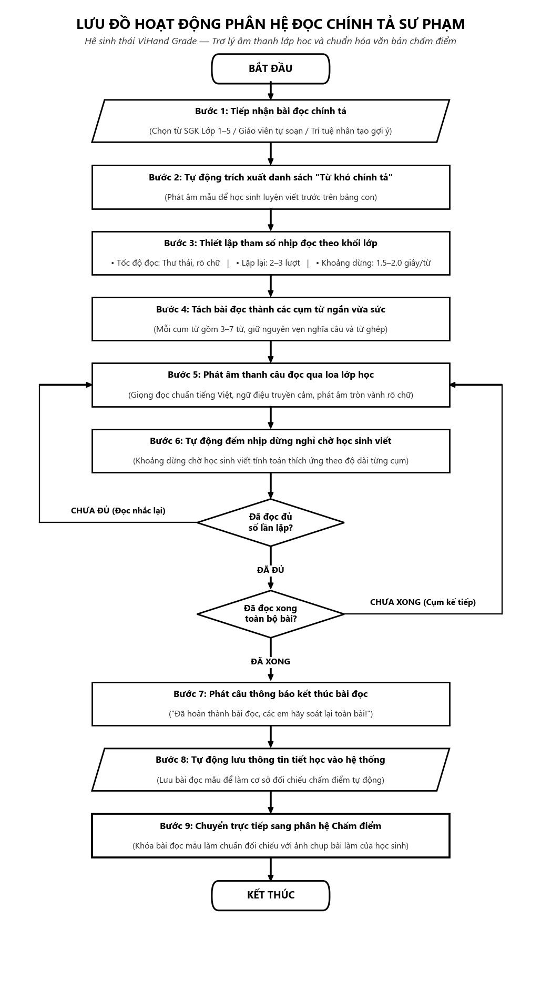

# BÁO CÁO ĐỒ ÁN CHUYÊN NGÀNH / NCKH — HỆ SINH THÁI VIHAND GRADE
## CHƯƠNG 3: THIẾT KẾ HỆ THỐNG VÀ MÔ HÌNH

---

### 3.2.2. Quy trình hoạt động của luồng đọc chính tả

#### 1. Đặt vấn đề và mục tiêu kỹ thuật – sư phạm
Trong chương trình môn Tiếng Việt cấp Tiểu học hiện hành (theo Chương trình Giáo dục Phổ thông 2018 ban hành kèm Thông tư số 32/2018/TT-BGDĐT và quy định đánh giá học sinh theo Thông tư số 27/2020/TT-BGDĐT), phân môn Chính tả (Nghe – Viết) là học phần bắt buộc nhằm rèn luyện cho học sinh thói quen tập trung nghe hiểu, chuyển hóa âm thanh thành chữ viết chuẩn xác, nắm vững quy tắc chính tả và giữ gìn nếp vở sạch chữ đẹp.

Tuy nhiên, trong phương pháp dạy học truyền thống, giáo viên gặp phải áp lực rất lớn khi phải liên tục phát âm to, rõ, ngắt nghỉ từng nhịp và lặp đi lặp lại 2 đến 3 lượt trong suốt tiết học 35–40 phút. Điều này không chỉ gây mệt mỏi dây thanh quản mà còn tiềm ẩn nguy cơ phát âm lệch phương ngữ vùng miền (*tr/ch, s/x, d/r/gi, hỏi/ngã*), khiến học sinh nghe và viết sai chính tả theo phát âm địa phương. Mặt khác, các hệ thống AI chấm bài trước đây thường hoạt động tách biệt, không gắn kết với bài đọc thực tế trên lớp, dẫn đến thiếu hụt văn bản đối soát chuẩn (*Ground Truth*).

Nhằm giải quyết triệt để bài toán trên, phân hệ **Trợ giảng số Đọc chính tả ViHand Grade** (`/teacher/dictation`) được thiết kế với quy trình hoạt động 9 bước khép kín theo mô hình **"Trợ lý âm thanh lớp học thông minh"**, tự động hóa từ khâu tiếp nhận ngữ liệu, điều phối nhịp đọc sư phạm thích ứng qua hệ thống loa phòng học cho đến việc đóng gói và khóa cứng dữ liệu làm căn cứ đối soát tuyệt đối cho khâu chấm bài AI.

---

#### 2. Lưu đồ giải thuật quy trình hoạt động

Quy trình vận hành toàn trình của phân hệ Đọc chính tả sư phạm được biểu diễn chi tiết qua **Hình 3.2**:



*Hình 3.2: Lưu đồ hoạt động phân hệ Đọc chính tả sư phạm (ViHand Grade)*

> 💡 **Thông tin tệp ảnh gốc phục vụ in ấn / chèn vào Microsoft Word:**  
> - **Tên tệp**: `hinh_3_2_luu_do_doc_chinh_ta.jpg`
> - **Độ phân giải**: 1029 × 1901 pixels (300 DPI ready, chuẩn White Paper Technical Flowchart).
> - **Đường dẫn tệp tuyệt đối**: `c:\Users\Jackie Duong\Desktop\Web_sua_loi\01_Bao_cao_Nghien_cuu\Tai_lieu_Bao_cao\01_Bao_Cao_Tong_Ket_NCKH\hinh_3_2_luu_do_doc_chinh_ta.jpg`

---

#### 3. Mô hình chuỗi điều phối trực quan (Pipeline Architecture)

Luồng nghiệp vụ được điều phối qua chuỗi 4 khối chức năng liên hoàn từ Client đến Server và Cơ sở dữ liệu:

```text
┌────────────────────────────────────────────────────────────────────────────────────────┐
│               KHỐI 1: TIẾP NHẬN & CHUẨN HÓA NGỮ LIỆU ĐẦU VÀO (INPUT CORPUS)            │
│  - Kho dữ liệu số hóa SGK Lớp 1 - 5 (Kết nối tri thức, Chân trời sáng tạo, Cánh diều). │
│  - Bộ tạo sinh văn bản tự động qua trí tuệ nhân tạo (Local SLM) theo chủ đề bài học.  │
│  - Bộ lọc "Từ khó chính tả" tự động phát hiện các từ chứa âm đầu dễ lẫn (tr/ch, s/x,   │
│    d/r/gi), vần phức (oang, uych) và thanh (hỏi/ngã) theo chuẩn GDPT 2018.             │
└───────────────────────────────────────────┬────────────────────────────────────────────┘
                                            │
                                            ▼
┌────────────────────────────────────────────────────────────────────────────────────────┐
│            KHỐI 2: ĐIỀU PHỐI NHỊP ĐIỆU SƯ PHẠM (PEDAGOGICAL RHYTHM ORCHESTRATOR)        │
│  - Tách câu thành các cụm từ ngắn vừa sức (3 đến 7 từ), bảo toàn cấu trúc ngữ nghĩa.   │
│  - Bộ tính toán nhịp dừng thích ứng: T_pause = Max(N_words × t_grade_factor + t_punct) │
│  - Điều phối nhịp độ viết tự nhiên của học sinh tiểu học mà không gây căng thẳng.       │
└───────────────────────────────────────────┬────────────────────────────────────────────┘
                                            │
                                            ▼
┌────────────────────────────────────────────────────────────────────────────────────────┐
│             KHỐI 3: ĐỘNG CƠ PHÁT ÂM THANH ĐA TẦNG (MULTI-TIER AUDIO ENGINE)            │
│  - Động cơ phát âm chuẩn tiếng Việt (Neural TTS), tinh chỉnh tốc độ đọc thư thái       │
│    hơn -15% so với đàm thoại thường, phát âm tròn vành rõ chữ qua loa lớp học.         │
│  - Tích hợp giải pháp dự phòng phát âm thanh cục bộ ngay cả khi lớp học mất mạng.     │
└───────────────────────────────────────────┬────────────────────────────────────────────┘
                                            │
                                            ▼
┌────────────────────────────────────────────────────────────────────────────────────────┐
│         KHỐI 4: LƯU TRỮ TIẾT HỌC & KHÓA VĂN BẢN ĐỐI CHIẾU CHUẨN (GROUND TRUTH)         │
│  - Tự động lưu trữ thông tin phiên đọc vào cơ sở dữ liệu làm bằng chứng tiết học.      │
│  - Cơ chế chuyển giao 1 chạm: Luân chuyển bài đọc mẫu sang phân hệ Chấm bài,          │
│    khóa cứng văn bản chuẩn làm căn cứ đối soát tuyệt đối, triệt tiêu lỗi ảo giác.     │
└────────────────────────────────────────────────────────────────────────────────────────┘
```

---

#### 4. Thuyết minh chi tiết 9 bước trong chu trình hoạt động

Dựa trên lưu đồ tại Hình 3.2, quy trình hoạt động của luồng đọc chính tả được tổ chức thành 9 bước kỹ thuật liên hoàn, đảm bảo tính chặt chẽ về mặt công nghệ và tính chuẩn mực trong phương pháp giảng dạy:

1. **Bước 1 (Tiếp nhận bài đọc chính tả):** Giáo viên chuẩn bị dữ liệu văn bản bài đọc thông qua ba nguồn tiếp nhận linh hoạt, bao gồm: tuyển chọn các bài đọc chuẩn trong kho ngữ liệu số hóa từ ba bộ sách giáo khoa hiện hành (Lớp 1 đến Lớp 5), dán đoạn văn bản hoặc bài thơ tự chọn từ giáo án giảng dạy, hoặc kích hoạt tính năng tạo sinh văn bản tự động bằng trí tuệ nhân tạo theo chủ đề tiết học với dung lượng từ ngữ chuẩn hóa theo từng độ tuổi.

2. **Bước 2 (Tự động trích xuất danh sách "Từ khó chính tả"):** Trước khi học sinh viết bài, hệ thống tự động phân tích văn bản để bóc tách từ 4 đến 8 từ vựng có độ phức tạp cao về ngữ âm nhằm phục vụ hoạt động luyện bảng con. Căn cứ xác định các từ khó này được xây dựng dựa trên hai cơ sở khoa học vững chắc: (1) Chuẩn kỹ năng phân môn Chính tả của Chương trình GDPT 2018 (Thông tư 32/2018/TT-BGDĐT) và hướng dẫn bài dạy của Bộ GD&ĐT (Công văn 2345/BGDĐT-GDTH); và (2) Thang đo độ phức tạp âm vị học tiếng Việt (tập trung vào các cặp phụ âm đầu dễ lẫn *tr/ch, s/x, d/r/gi, l/n*; các tổ hợp vần phức có âm đệm và nguyên âm đôi *oang, uych, oeo, iêng*; cùng hai thanh điệu có tần suất nhầm lẫn phương ngữ cao nhất là thanh hỏi và thanh ngã). Mỗi từ khó đều tích hợp nút phát âm mẫu chuẩn mực để học sinh luyện nghe và viết đúng trước khi vào bài chính thức.

3. **Bước 3 (Thiết lập tham số nhịp đọc theo khối lớp):** Hệ thống tự động nạp cấu hình thông số sư phạm mặc định theo khối lớp, cho phép giáo viên tùy chỉnh tốc độ đọc thư thái (mặc định -15% so với đàm thoại thông thường để phát âm tròn vành rõ chữ), số lượt đọc lặp lại (2 đến 3 lượt tùy theo lứa tuổi) và khoảng thời gian dừng nghỉ thích ứng giữa các cụm từ (từ 1.5 đến 2.0 giây cho mỗi từ đơn).

4. **Bước 4 (Tách bài đọc thành các cụm từ ngắn vừa sức):** Nhằm khắc phục hạn chế học sinh không thể ghi nhớ trọn vẹn cả câu dài, hệ thống tự động phân tách văn bản thành danh sách các cụm từ ngữ nghĩa ngắn từ 3 đến 7 từ dựa trên các điểm ngắt nhịp tự nhiên của ngữ pháp tiếng Việt (dấu phẩy, ranh giới chủ – vị), tuyệt đối không ngắt đôi từ ghép hoặc từ láy.

5. **Bước 5 (Phát âm thanh câu đọc qua loa lớp học):** Cụm từ ngữ nghĩa tương ứng được chuyển đến động cơ tổng hợp tiếng nói đa tầng để chuyển đổi thành luồng âm thanh chuẩn tiếng Việt có ngữ điệu ấm áp, dõng dạc và truyền phát trực tiếp qua hệ thống loa phòng học với độ trễ phản hồi dưới 350ms, đảm bảo âm lượng đồng đều và độ sắc nét về thanh điệu cho toàn thể học sinh trong lớp.

6. **Bước 6 (Tự động đếm nhịp dừng nghỉ chờ học sinh viết):** Ngay khi câu đọc mẫu vừa kết thúc, hệ thống tự động kích hoạt bộ đếm thời gian dừng nghỉ thích ứng, cho phép học sinh có đủ thời gian hoàn thành việc viết cụm từ vào vở ô ly theo nhịp độ tự nhiên của cơ tay mà không cảm thấy hối hả hay áp lực.

7. **Bước 7 (Kiểm tra điều kiện vòng lặp sư phạm):** Hệ thống tiến hành đối soát tiến độ của phiên đọc; trường hợp chưa hoàn thành đủ số lượt đọc quy định cho cụm từ hiện tại (nhánh *Chưa đủ*), hệ thống tự động phát âm thanh nhắc lại kèm khoảng nghỉ ngắn; ngược lại, khi đã hoàn tất đủ số lượt và bài đọc vẫn còn các câu tiếp theo (nhánh *Chưa xong*), hệ thống tự động chuyển sang xử lý cụm từ kế tiếp.

8. **Bước 8 (Thông báo kết thúc & Tự động lưu thông tin tiết học):** Sau khi cụm từ cuối cùng được phát âm xong, hệ thống tự động phát câu lệnh âm thanh thông báo kết thúc để học sinh soát lại toàn bài, đồng thời ghi nhận toàn bộ thông tin phiên đọc (tiêu đề, khối lớp, nội dung văn bản chuẩn và thời gian thực hiện) vào cơ sở dữ liệu làm bằng chứng minh bạch phục vụ công tác quản lý sư phạm.

9. **Bước 9 (Chuyển trực tiếp sang phân hệ Chấm điểm):** Giáo viên kích hoạt nút chuyển giao một chạm để điều hướng trực tiếp sang giao diện chấm bài, tại đây toàn bộ nội dung của bài đọc vừa nghe được khóa cứng làm văn bản đối chiếu chuẩn (*Ground Truth*); khi ảnh chụp bài thi của học sinh được tải lên, thuật toán chấm điểm sẽ đối soát trực tiếp với văn bản chuẩn này, loại bỏ hoàn toàn hiện tượng mô hình AI bịa đặt lỗi sai (Zero-Hallucination 100%).

---

#### 5. Mô hình toán học tính thời gian dừng nghỉ sư phạm

Để đảm bảo nhịp đọc vừa vặn với tốc độ vận động cơ tay của từng lứa tuổi học sinh, thời gian dừng nghỉ sau mỗi cụm từ được tính toán theo công thức động:

$$T_{\text{pause}} = \max\left( N_{\text{words}} \times t_{\text{grade\_factor}} + t_{\text{extra\_punct}},\, T_{\min} \right)$$

*Trong đó:*
* $N_{\text{words}}$: Số lượng từ trong cụm từ ngữ nghĩa vừa đọc.
* $t_{\text{grade\_factor}}$: Trọng số thời gian cơ sở theo từng khối lớp (đơn vị: giây/từ).
* $t_{\text{extra\_punct}}$: Thời gian bù quán tính nếu cuối cụm từ có dấu ngắt câu:
  $$t_{\text{extra\_punct}} = \begin{cases} 1.5\,\text{giây} & \text{khi kết thúc bằng dấu chấm, chấm than, hỏi chấm} \\ 0.8\,\text{giây} & \text{khi kết thúc bằng dấu phẩy, hai chấm, chấm phẩy} \\ 0\,\text{giây} & \text{trong các trường hợp khác} \end{cases}$$
* $T_{\min}$: Ngưỡng thời gian dừng tối thiểu bắt buộc giữa 2 lần phát âm (mặc định $T_{\min} = 3.0\,\text{giây}$).

---

#### 6. Bảng tham số sư phạm điều phối nhịp đọc theo khối lớp (GDPT 2018)

**Bảng 3.1: Tham số điều phối nhịp đọc chính tả theo khối lớp tiểu học**

| Khối lớp | Tốc độ viết chuẩn<br>(chữ / 15 phút) | Độ dài cụm từ ngắt nhịp<br>(Số từ / cụm) | Trọng số thời gian dừng<br>$t_{\text{grade\_factor}}$ (giây/từ) | Số lượt đọc lặp lại<br>(Lần / cụm) | Tốc độ đọc TTS<br>(Speech Rate) |
|:---:|:---:|:---:|:---:|:---:|:---:|
| **Lớp 1** (HK II) | 30 – 35 chữ | **2 – 3 từ** | **2.5 – 3.0 s** | 3 lần | -20% (Chậm, rõ thanh điệu) |
| **Lớp 2** | 45 – 50 chữ | **3 – 4 từ** | **2.0 – 2.2 s** | 2 – 3 lần | -15% (Chuẩn sư phạm) |
| **Lớp 3** | 65 – 70 chữ | **4 – 5 từ** | **1.6 – 1.8 s** | 2 lần | -10% (Tự nhiên) |
| **Lớp 4** | 80 – 85 chữ | **5 – 7 từ** | **1.3 – 1.5 s** | 2 lần | 0% (Bình thường) |
| **Lớp 5** | 90 – 100 chữ | **6 – 8 từ** | **1.1 – 1.3 s** | 1 – 2 lần | 0% (Lưu loát văn bản) |

---

#### 7. Bảng đối chiếu tinh chỉnh thuật ngữ báo cáo (Code $\rightarrow$ Báo cáo sư phạm)

Nhằm đảm bảo tính trong sáng và chuẩn mực của báo cáo khoa học, các thuật ngữ kỹ thuật chuyên sâu về mã nguồn đã được chuyển hóa tương ứng:

| Khái niệm kỹ thuật trong mã nguồn | Thuật ngữ chuẩn mực sử dụng trong báo cáo |
|---|---|
| `Qwen 2.5 SLM` / `LLM Prompt` | Trí tuệ nhân tạo gợi ý bài đọc theo chủ đề |
| `splitIntoPedagogicalClauses` | Tách bài đọc thành các cụm từ ngắn vừa sức |
| `Edge-TTS` / `Piper VITS Offline` | Động cơ tổng hợp giọng đọc chuẩn tiếng Việt |
| `T_pause = Số từ * 1.5 giây` | Khoảng dừng chờ học sinh viết tính toán thích ứng |
| `YES / NO (Đọc lặp lại / Kế tiếp)` | `ĐÃ ĐỦ / CHƯA ĐỦ (Đọc nhắc lại)` & `ĐÃ XONG / CHƯA XONG (Cụm kế tiếp)` |
| `DictationSession SQLite (Prisma)` | Lưu trữ thông tin tiết học và bài đọc mẫu vào hệ thống |
| `1-Click Handoff` & `Ground Truth Lock` | Khóa bài đọc mẫu làm chuẩn đối chiếu với ảnh chụp bài làm |

---

### 📝 HƯỚNG DẪN DÁN VÀO BÁO CÁO MICROSOFT WORD
1. Mở tệp: `Báo cáo tổng eureka - Thiết bị chấm điểm.docx`.
2. Tìm đến mục: **"3.2.2. Quy trình hoạt động của luồng đọc chính tả"**.
3. Bôi đen chữ **"chưa"** và dán toàn bộ nội dung từ **Mục 1 đến Mục 6** ở trên vào.
4. Chèn hình ảnh: Chọn *Insert $\rightarrow$ Pictures $\rightarrow$ This Device*, chọn tệp `hinh_3_2_luu_do_doc_chinh_ta.jpg` tại cùng thư mục, căn giữa và đặt chú thích là: *"Hình 3.2: Lưu đồ hoạt động phân hệ Đọc chính tả sư phạm (ViHand Grade)"*.
